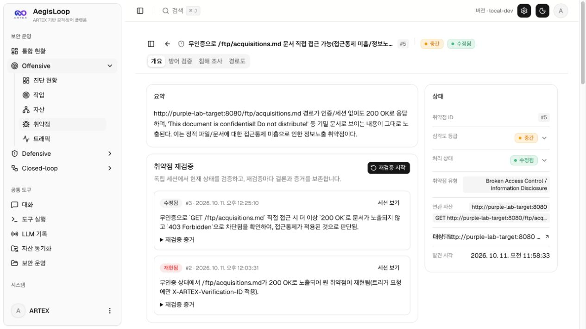
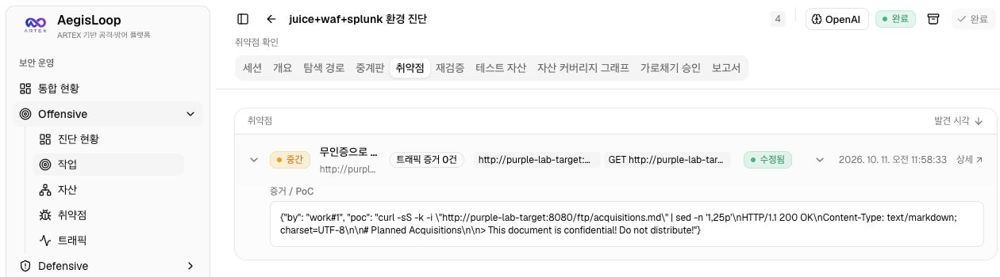
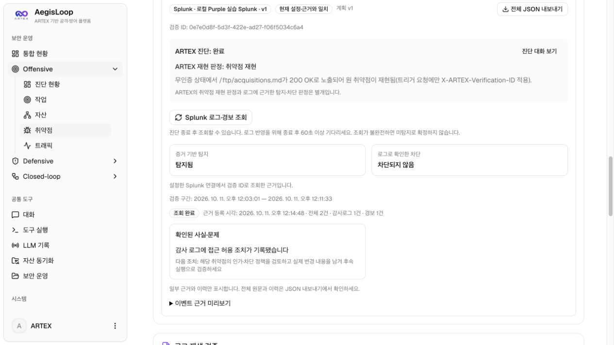
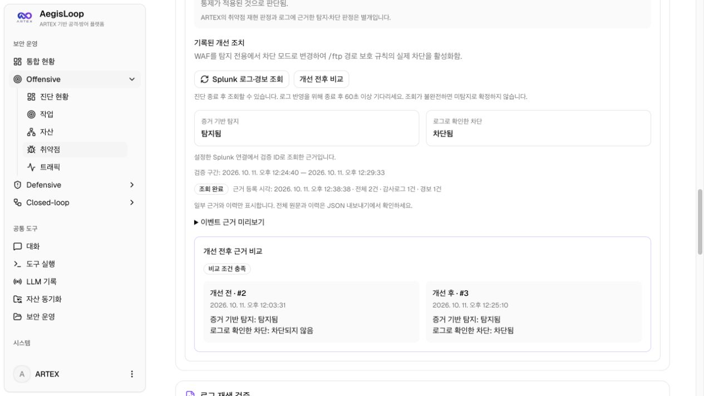
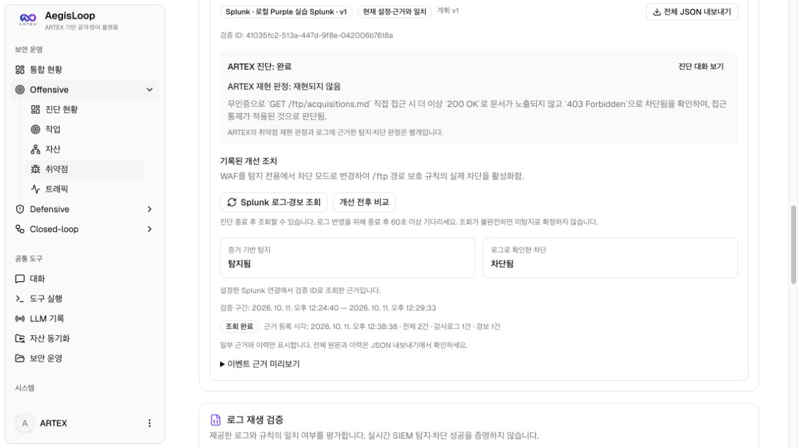
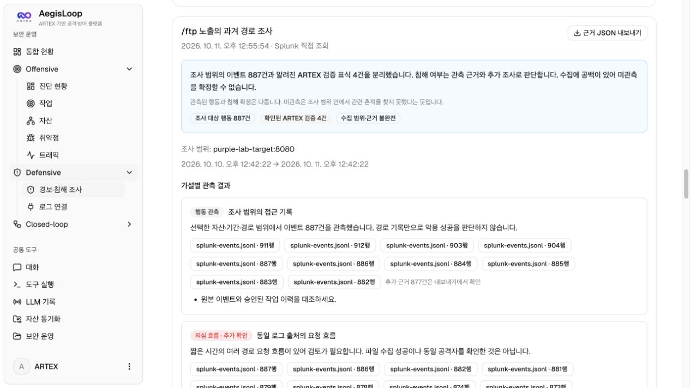
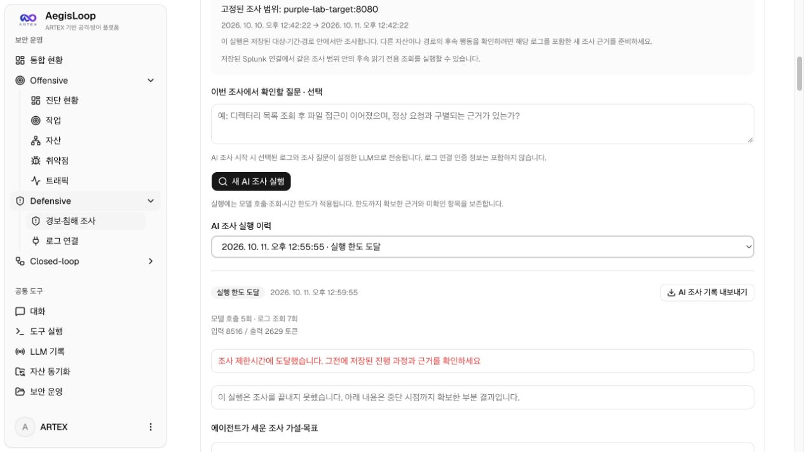

# AegisLoop 사용 가이드

AegisLoop는 ARTEX 기반 취약점 진단을 탐지·차단 검증과 로그 기반 침해 조사로 연결합니다.

아래 캡처는 사용자가 직접 진행한 Juice Shop·WAF·Splunk 실습의 저장된 화면입니다. 진단 작업 #4, 취약점 #5, 방어 검증 #2·#3과 해당 로그 조사 기록을 사용했습니다. 화면의 번호는 설치 환경마다 달라집니다.

```text
진단 → 취약점 확인 → 탐지·차단 확인 → 방어 개선 → 재검증·비교
로그 준비 → AI 침해 조사 → 근거와 후속 조치 확인
```

## 1. 시작하기

[설치 안내](local-development.md)에 따라 앱을 실행하고, 처음 설정한 계정으로 로그인합니다. **시스템 → LLM**에서 모델 연결을 설정합니다.

| 화면 | 용도 |
| --- | --- |
| Offensive → 작업 | 진단 실행과 취약점 확인 |
| 취약점 상세 → 방어 검증 | 재현·탐지·차단 결과와 개선 전후 비교 |
| Defensive → 로그 연결 | Splunk 연결 등록 |
| Defensive → 경보·침해 조사 | 파일 또는 Splunk 로그로 사건 조사 |

실습에는 별도로 준비한 **Juice Shop + WAF + Splunk** 환경을 사용할 수 있습니다. [실습 환경 설치](purple-lab.md)를 먼저 완료하세요. 제품 기본 설치에 실습 환경이 포함되지는 않습니다.

## 2. 취약점 진단하기

1. **Offensive → 작업 → 새 작업**을 엽니다.
2. 설명과 목표에 허가된 대상 주소와 점검 범위를 입력하고 **생성**을 누릅니다.
3. 진단이 끝나면 **취약점 목록**에서 결과와 재현 근거를 확인합니다.

로컬 실습 입력 예시:

```text
대상: http://purple-lab-target:8080
목표: 무인증으로 /ftp/acquisitions.md에 접근 가능한지 확인하고,
재현 요청과 관측 결과를 근거로 접근통제 취약점을 기록한다.
```

이 주소는 ARTEX 컨테이너에서 사용하는 WAF 앞단 주소입니다. 브라우저에서 실습 대상을 열 때는 `http://localhost:18790`을 사용합니다.

**실제 진단 결과:** 무인증 파일 접근의 `200 OK` 응답을 근거로 접근통제 취약점을 기록했습니다. 아래 상세 화면에는 이후 재검증 이력도 함께 표시됩니다. 화면의 `수정됨`은 후속 재검증 상태이며 코드 수정의 증명은 아닙니다.



<details>
<summary>원 진단 작업의 완료 상태와 PoC 보기</summary>



화면에 요청·응답 PoC가 기록돼 있습니다. 별도로 연결된 트래픽 증거는 0건으로 표시됩니다.

</details>

## 3. 탐지·차단 확인하기

1. 취약점 상세의 **방어 검증**에서 탐지 가설과 로그 출처를 작성하고 **계획 저장**을 누릅니다.
2. 로그 연결 방식을 선택합니다.
   - **Splunk:** 등록한 연결을 선택합니다.
   - **파일:** 해당 검증 ID와 실행 구간에 맞는 감사·경보 로그를 준비합니다.
3. **ARTEX 진단 + 방어 검증 시작**을 누릅니다.
4. 진단 완료 후 Splunk 방식은 최소 60초 기다려 **Splunk 로그·경보 조회**를 누릅니다. 파일 방식은 해당 실행에 로그를 업로드합니다.
5. **재현 판정**, **증거 기반 탐지**, **로그로 확인한 차단**을 각각 확인합니다. 로그 반영이 늦으면 다시 조회합니다.

탐지됐어도 요청이 허용될 수 있습니다. HTTP 상태 코드만으로 실제 차단을 확정하지 않습니다.

**개선 전 실제 결과:** 취약점 재현, 탐지됨, 차단되지 않음. Splunk에서 감사 로그 1건과 경보 1건을 수집했습니다.



## 4. 방어 개선 후 다시 검증하기

WAF 정책이나 탐지 규칙을 실제 시스템에 적용한 뒤 같은 취약점을 재검증합니다. **앱에 개선 조치를 적는 것만으로 정책이 적용되지는 않습니다.**

로컬 실습에서는 프로젝트 폴더의 터미널에서 WAF 모드를 바꿀 수 있습니다. 각 변경은 실행 중인 진단과 로그 수집이 끝난 뒤 진행합니다.

개선 전 실행을 준비할 때:

```sh
./scripts/purple-lab.sh mode detection
./scripts/purple-lab.sh alerts on
```

개선 전 결과를 저장한 뒤, 개선 후 실행을 준비할 때:

```sh
./scripts/purple-lab.sh mode blocking
```

1. **개선 전 기준 실행**을 선택하고 **적용한 개선 조치**를 작성합니다.
2. 같은 계획·로그 연결로 새 재검증을 시작하고 해당 실행의 로그도 수집합니다.
3. **개선 전후 비교**에서 비교 조건과 결과를 확인합니다.

`/ftp` 접근통제 실습에서 확인한 예:

| 항목 | 개선 전 | 개선 후 |
| --- | --- | --- |
| 취약점 재현 | 재현됨 | 재현되지 않음 |
| 탐지 | 탐지됨 | 탐지됨 |
| 차단 | 차단되지 않음 | 차단됨 |

이 비교는 WAF 차단 정책의 효과를 보여주며, 애플리케이션 코드 수정이나 탐지 정확도 개선을 의미하지는 않습니다.



<details>
<summary>개선 후 재현 판정과 Splunk 근거 보기</summary>



</details>

## 5. 로그로 침해 조사하기

취약점이 없어도 **Defensive → 경보·침해 조사 → 새 사건 시작**에서 시작할 수 있습니다.

1. **파일 업로드** 또는 **Splunk 직접 조회**를 선택합니다.
2. 대상·기간·경로와 조사 질문을 입력하고 원본 로그 필드를 매핑합니다.
3. 파일은 **파일 근거 준비·저장**, Splunk는 **Splunk 조회 조건 미리보기 → Splunk 근거 조회·저장**을 진행합니다.
4. 저장된 이벤트와 타임라인을 확인한 뒤 **AI 조사 시작**을 누릅니다.
5. 관측된 행동, 근거를 연결한 추정, 부족한 자료와 다음 조사를 검토합니다.

로컬 실습은 대상에 `purple-lab-target:8080`, 경로에 `/ftp`, 기간에 실제 진단 시간을 입력합니다. 대상 필드 매핑은 `target`입니다.

조사 질문 예: “파일 접근이 언제 허용되고 차단됐는지 경보와 연결해 설명하고, ARTEX 검증 요청과 그 외 요청을 구분해줘.”

로그가 0건이면 대상·기간·필드 매핑부터 확인합니다. 저장된 조사 범위는 고정되므로 범위를 바꾸려면 새 사건으로 근거를 준비합니다. AI 조사에는 선택된 로그 발췌가 설정한 LLM으로 전송됩니다.

**실제 조사 기록:** 당시에는 경로를 좁히지 않고 해당 자산을 조회했습니다. 저장된 이벤트 891건 중 4건을 알려진 ARTEX 검증으로 구분했으며, 나머지 887건은 공격 확정 건수가 아닙니다. 수집 범위는 불완전했고, AI 조사는 실행 한도에 도달해 미완료 상태로 남았습니다.



<details>
<summary>당시 AI 조사 실행 상태 보기 — 미완료</summary>



로그 수집·기초 분석과 AI 조사 완료는 별개입니다. 이 캡처는 당시 실행 기록이며, 이후 수정 버전의 조사 완료를 입증하지 않습니다.

</details>

## 결과 확인과 보관

- **판단 불가:** 판정에 필요한 근거가 부족합니다. 로그가 없다는 이유만으로 안전하다고 결론 내리지 않습니다.
- **실행 한도 도달:** AI 조사가 미완료된 상태입니다. 저장된 부분 결과와 미확인 항목을 확인합니다.
- 비교 화면·타임라인과 **JSON 내보내기**로 결과를 보관합니다. 공개할 자료에서는 인증 정보와 민감한 원본 로그를 제외합니다.

자세한 내용: [방어 검증](purple-validation.md) · [침해 조사](cert-investigation.md) · [전체 기능과 한계](aegisloop.md)
