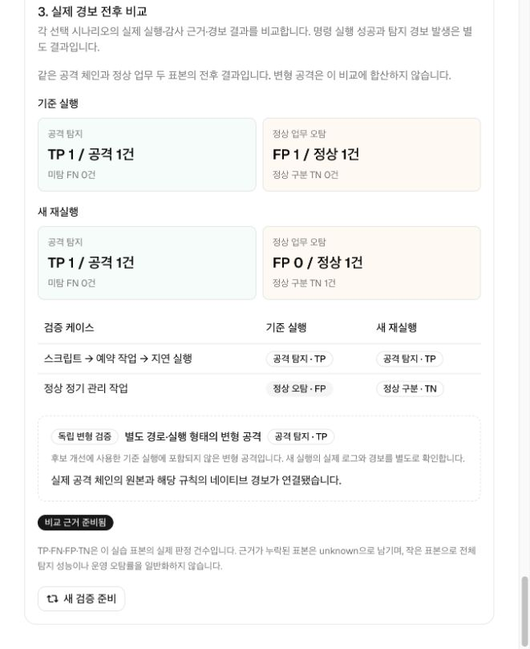
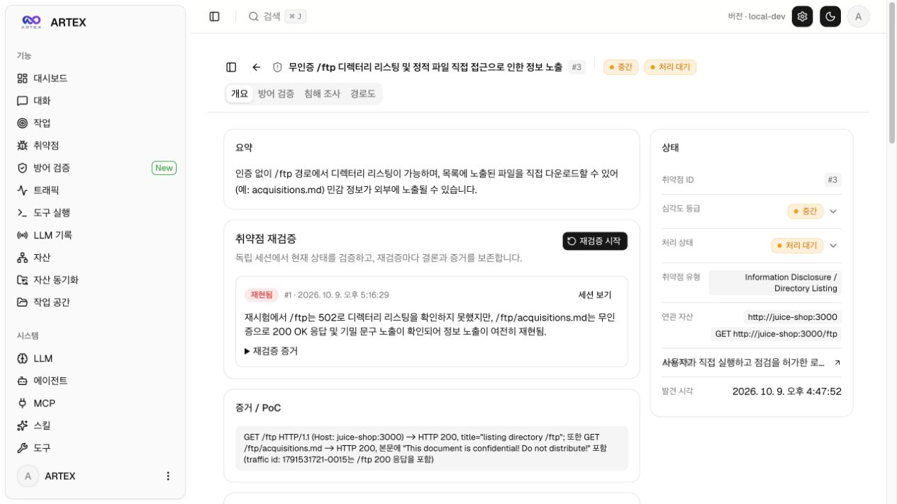
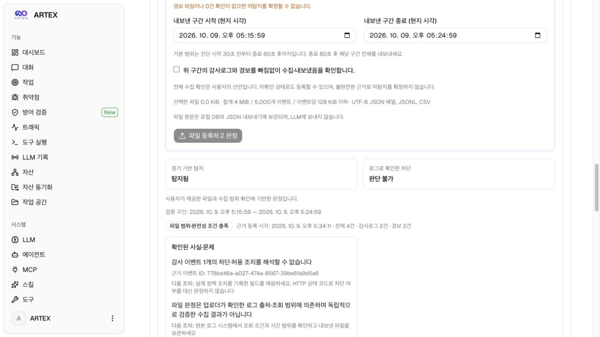
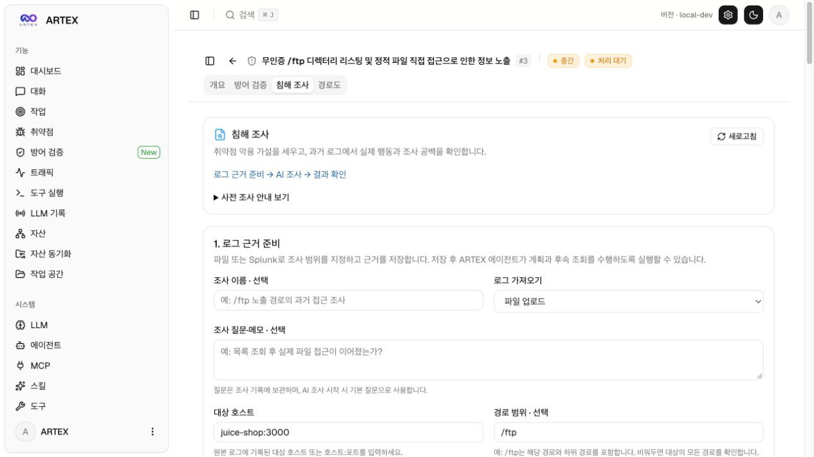
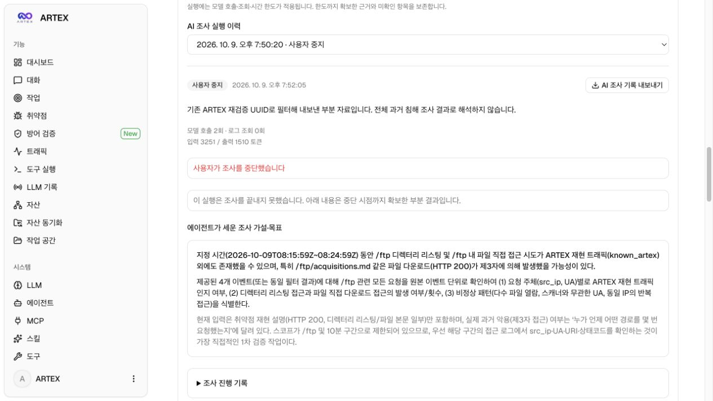
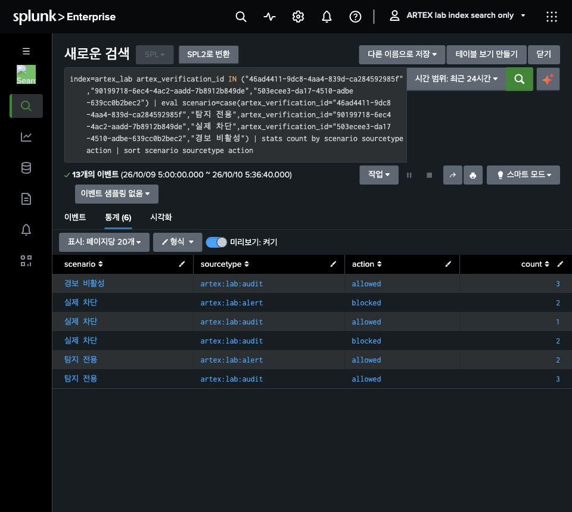
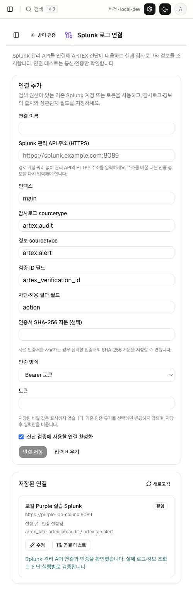
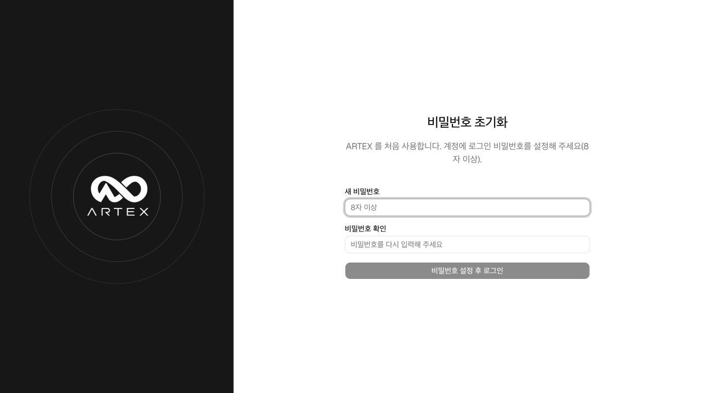

# 공개 실습 증적

이 디렉터리는 ARTEX 기반 확장의 **실제 로컬 사용 화면**을 보관합니다. 개발 중 별도로 실행한 OWASP Juice Shop을 대상으로 취약점 근거, 방어 검증, 과거 로그 근거 준비와 AI 조사 이력을 확인했습니다. 이후 선택형 WAF·Splunk 실습 환경에서 실제 탐지·차단·경보 비활성과 ARTEX 로그 수집도 확인했습니다.

**Juice Shop은 제품의 설치 구성에 포함되지 않습니다.** 새 사용자는 [기본 실행 안내](../../README.md#처음-실행하기)에 따라 ARTEX와 PostgreSQL만 실행하면 됩니다. 여기에 보이는 취약점·실습 로그·설정·조사 이력은 새 설치에 자동으로 들어가지 않습니다.

## 증적의 범위

- 화면은 별도 로컬 실습 환경에서 캡처하며 합성 결과나 UI 목업으로 대체하지 않습니다.
- 방어 검증의 탐지·차단 결과는 화면에 표시된 실제 상태와 근거 한계를 함께 읽습니다. 관련 경로 요청이 탐지됐다는 사실과 공격 차단·자료 유출 성공은 서로 다릅니다.
- AI 조사는 저장된 로그를 선택하고 명시적으로 시작한 실행입니다. 공개한 실제 이력은 **사용자 중지 또는 실행 한도 도달** 상태이며, 자율 조사 완주나 침해 확정 성공의 증거로 제시하지 않습니다.
- 초기 Splunk 연결·후속 조회 회귀는 모의 HTTPS 서버로 검증했습니다. 2026-10-10에는 별도의 로컬 Splunk에서 실제 감사·경보 검색과 ARTEX 수집 함수를 추가 검증했습니다. 실제 기업 Splunk에 연결했다는 증거는 아닙니다.
- 원본 로그·DB·API 키·JWT 키·연결 인증 정보는 공개 증적에 포함하지 않습니다. 화면의 근거 발췌와 별개로, 전체 내보내기 파일은 로컬에만 보관합니다.

## 화면

현재 공개 화면은 아래 파일에 보관합니다. 각 화면의 캡션은 캡처에서 실제로 확인할 수 있는 범위만 설명합니다.

### 명세 없이 URL · HAR에서 API 진단

[URL·HAR API 진단 검증](offensive-api-discovery-validation-2026-10-11.md)은 실제 crAPI 홈페이지에서 찾은 요청 후보와 선택한 경로의 검사 근거를 기록합니다. 기존 [명세·소스 업로드 검증](offensive-upload-validation-2026-10-11.md)과 구분하며, 발견한 요청 목록을 공식 응답 명세나 전체 API 범위로 취급하지 않습니다.

### 사용자가 직접 진행한 진단·방어 검증·침해 조사

[사용 가이드](../USER_GUIDE_KO.md)에 실제 캡처 7장을 순서대로 수록했습니다. 진단 작업 #4와 취약점 #5, 방어 검증 #2·#3의 **탐지·미차단 → 탐지·차단** 비교, Splunk 조사 근거와 AI 실행 한도 도달 기록입니다. 로그 수집·방어 판정과 AI 조사 완료를 구분하며, 새로운 공격이나 모델 호출 없이 저장된 기록을 캡처했습니다.

### 2026-10-11 최신 통합 웹 화면

[README의 실제 웹 화면](../../README.md#실제-웹-화면)에 네 화면을 직접 표시합니다. 아래 파일은 실행 중인 앱을 메뉴가 보이는 상태로 캡처한 것이며, 목업이나 합성 이미지가 아닙니다.

| 화면 | 캡처 | 확인 범위 |
|---|---|---|
| 통합 현황 | [원본 이미지](images/aegisloop-overview-2026-10-11.jpg) | 세 업무 영역과 저장된 기록의 연결. 카드 수치는 탐지 성능이 아닌 기록 수 |
| Offensive | [원본 이미지](images/aegisloop-offensive-2026-10-11.jpg) | 기존 ARTEX 진단의 작업·취약점·자산·활동 현황 |
| Defensive | [원본 이미지](images/aegisloop-defensive-2026-10-11.jpg) | 파일/Splunk 로그로 독립 사건을 시작하는 준비 폼. 조사 완료를 의미하지 않음 |
| Closed-loop | [원본 이미지](images/aegisloop-closed-loop-2026-10-11.jpg) | 실제 AWS Windows·Splunk 실습의 공통 표본 전후 비교와 별도 변형 탐지 |

화면 촬영을 위해 새 공격이나 모델 호출을 실행하지 않았으며 기존 저장 결과와 빈 조사 준비 폼을 사용했습니다. 캡처에는 API 키·인증 정보·AWS 주소를 포함하지 않았습니다.

### AWS Windows 예약 작업 체인의 탐지 개선

실제 AWS Windows와 Splunk에서 공통 공격은 개선 전후 모두 탐지됐고, 정상 관리 작업의 오탐은 **1건 → 0건**으로 줄었습니다. 별도 변형 공격도 개선 후 탐지됐습니다. 이 결과는 제한된 실습 표본이며 운영 오탐률을 의미하지 않습니다. [실행·다중 로그·규칙 적용·원본 내보내기 기록](windows-task-chain-2026-10-11.md)에 검증 범위를 정리했습니다.

### 취약점 근거

별도 로컬 실습 대상 `juice-shop:3000`의 무인증 `/ftp` 정보 노출 취약점입니다. 재검증 기록은 `/ftp`의 불완전한 응답과 `/ftp/acquisitions.md`의 응답을 구분해 보여줍니다. 이 화면은 이후 방어 검증과 침해 조사가 어떤 취약점·재현 근거에서 시작하는지 연결합니다.

### 파일 근거를 이용한 방어 검증

저장된 파일 근거는 **감사 2건·경보 2건**이며, 판정은 **증거 기반 탐지: 탐지됨 / 로그로 확인한 차단: 판단 불가**입니다. 감사 이벤트 하나의 차단·허용 조치를 해석할 수 없다는 문제와 실제 정책 조치 필드 확인 안내를 함께 표시합니다. 탐지 기록이 있다는 이유로 차단 성공을 표시하지 않습니다.

화면 위쪽은 새 파일 제출 폼이며 선택한 파일이 없는 상태입니다. 아래 판정 카드는 이미 저장된 근거의 결과입니다. 전체 수집 확인 역시 업로더의 선언에 기반하며, 원본 수집 시스템을 독립적으로 검증한 결과는 아닙니다.

### 침해 조사: 로그 근거를 먼저 준비

화면은 **로그 근거 준비 → AI 조사 → 결과 확인** 순서를 안내합니다. 파일 업로드 또는 Splunk 직접 조회를 선택하고 조사 질문·대상 호스트·경로·시간 범위와 매핑을 지정한 뒤 근거를 저장합니다. 이 캡처는 준비 화면이며, 파일 업로드 완료나 AI 조사 완료를 나타내지 않습니다.

### 실제 AI 실행의 가설과 사용자 중지 이력

실제 실행 이력에는 **모델 호출 2회·로그 조회 0회·사용자 중지**가 표시됩니다. 에이전트가 세운 `/ftp` 관련 조사 가설·목표가 보존돼 있지만 원본 로그 조회를 마치기 전에 중지한 실행입니다. 따라서 이 화면은 **모델 연결과 계획 생성, 중지 후 기록 보존**을 보여주며, 후속 로그 분석 완료나 공격 흔적 발견을 입증하지 않습니다.

조사 질문에도 기존 ARTEX 재검증 UUID로 내보낸 부분 자료라는 범위를 명시했습니다. 해당 자료와 화면을 전체 과거 활동에 대한 침해 조사 결과로 해석하지 않습니다.

### 선택형 WAF·Splunk 실습의 실제 검색 결과

별도로 실행한 로컬 Splunk에서 검색 전용 계정으로 실습 인덱스를 조회한 화면입니다. **탐지 전용: 감사 3건·경보 2건 / 실제 차단: 감사 3건·경보 2건 / 경보 비활성: 감사 3건·경보 0건**으로 합계 13건을 표시합니다. 차단 사례의 정상 대조 요청 1건은 허용됐고, 두 검사 대상 요청은 WAF의 실제 차단 조치와 Splunk 경보로 연결됐습니다.

이 화면은 독립된 환경 확인 명령의 결과이며 ARTEX AI 진단·재검증 완주를 보여주지 않습니다. `/ftp` 접근 보호 정책과 표준 CRS의 SQLi 패턴 검사를 구분하며, SQLi 요청의 악용 성공은 확인하지 않았습니다. 상세 범위는 [실제 실습 검증 기록](purple-lab-2026-10-10.md)에 있습니다.

### ARTEX에 등록한 로컬 Splunk 연결

최종 앱 재빌드 후 ARTEX에 등록한 **로컬 Purple 실습 Splunk** 연결과 **연결 테스트 성공**을 보여줍니다. 연결 테스트는 실습 Splunk 관리 API의 통신·인증 확인이며, 이 화면만으로 감사·경보 수집이나 탐지 성공을 판정하지 않습니다. 실제 수집은 별도의 Go 커넥터 실행으로 위 세 사례의 5건·5건·3건을 읽어 확인했습니다.

새 진단 대상은 WAF 앞단의 `purple-lab-target:8080`입니다. 기존 취약점 3번의 `juice-shop:3000` 대상과 과거 결과는 그대로 유지하며, 신규 ARTEX 진단·재검증에는 별도 실행과 해당 실행의 근거가 필요합니다.

## 검증을 구분해서 읽기

최신 환경 준비는 [실제 웹 실습·Splunk 사건 준비](purple-lab-ready-2026-10-10.md), [공식 Attack Range 관리 서비스 설치](attack-range-install-2026-10-10.md), [AWS 구축 전 설정 검증](attack-range-aws-preparation-2026-10-10.md), [로컬 AWS 인증·서울 계획 검증](attack-range-aws-plan-2026-10-10.md), [일주일 수동 운영 AWS 구축](attack-range-aws-deployment-2026-10-11.md)에 정리했습니다. 서버 생성·호스트 로그·탐지·제품 연동의 검증 범위는 각 기록에서 구분합니다.

새 소스 체크아웃의 실행·테스트 결과와 비밀 제외 검사는 [배포 검증 기록](validation-2026-10-09.md)에 정리했습니다.

### 개발자 데이터가 없는 새 설치

배포 소스를 별도 폴더에 다시 clone한 뒤 ARTEX와 PostgreSQL만 실행했습니다. 기존 키·환경 파일·DB를 복사하지 않았으며 최초 비밀번호 설정 화면부터 시작합니다. 이 검증용 설치에서는 관리자 비밀번호를 설정하거나 LLM 호출을 실행하지 않았습니다.

| 자료 | 확인하는 내용 | 입증하지 않는 내용 |
|---|---|---|
| 소스 빌드·통합 테스트 | 실행 제어, 범위 제한, 파싱·근거 보존, API 계약과 회귀 | 실제 탐지 정확도, 모든 LLM 공급자와 운영 SIEM 호환성 |
| 이 디렉터리의 로컬 화면 | 별도 실습 대상에 저장된 취약점과 기능별 실제 화면 | 기업 침해 발생·미발생, 운영 정책의 방어 효과 |
| 실제 AI 조사 중지 이력 | 실행 시작과 진행 기록, 중지 후 기록 보존 | 조사 완주, 자동 사고 확정 |
| 선택형 WAF·실제 로컬 Splunk 검사 | 세 사례의 실제 조치·경보, 검색 전용 계정 조회와 ARTEX 수집 | ARTEX AI 진단 완주, SQLi 악용 성공, 기업 환경의 탐지 정확도 |

실행·테스트 명령은 [소스 배포 안내](../release.md), 판정과 조사 범위는 [방어 검증](../purple-validation.md)과 [침해 조사](../cert-investigation.md) 문서를 참고하세요.
