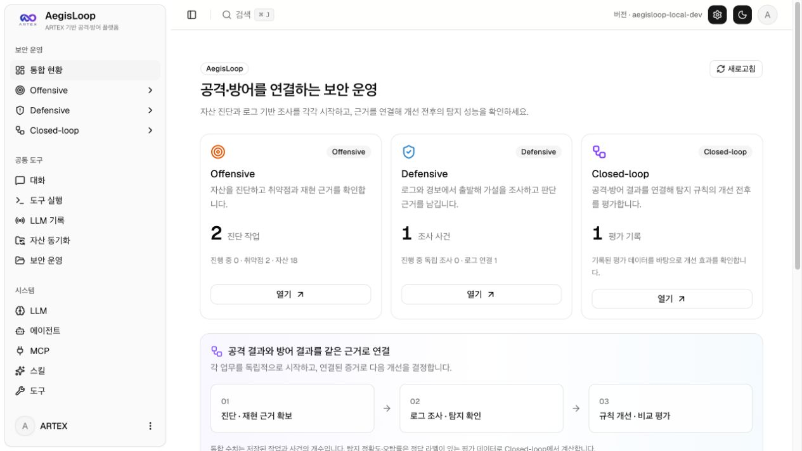
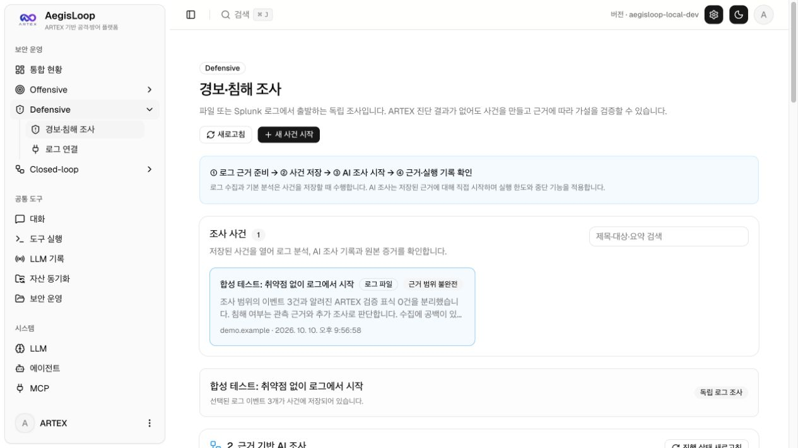
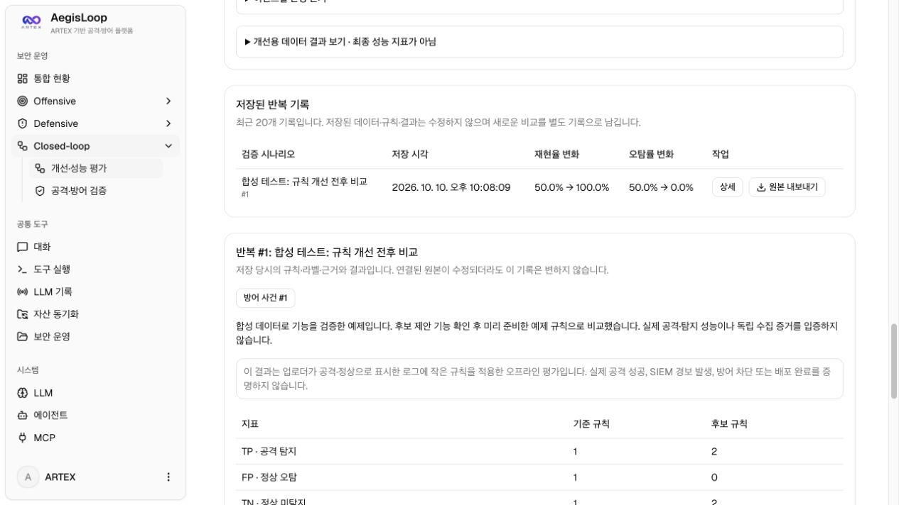
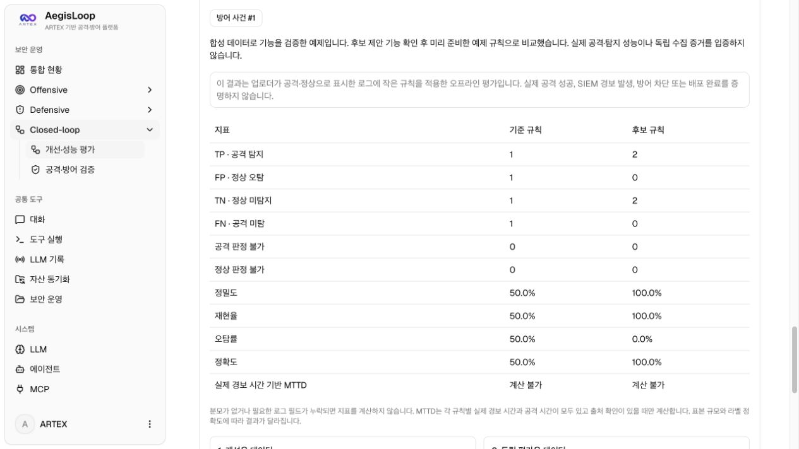

# AegisLoop 첫 MVP 검증 기록

2026-10-10 로컬 ARTEX·PostgreSQL 환경에서 확인했습니다. 아래 새 화면은 제품 기능의 구현 증거입니다. 기존 Juice Shop 실습 증거와 구분하며, 합성 예제를 실제 공격·침해·탐지 성공 사례로 제시하지 않습니다.

## 확인한 화면

한 웹앱에서 Offensive·Defensive·Closed-loop로 이동합니다. 통합 화면의 숫자는 저장된 작업·사건·평가 기록 수입니다. 전체 탐지 정확도나 공격 성공률로 해석하지 않습니다. 최종 화면에는 아래 합성 사건 1개와 평가 기록 1개가 포함됩니다.

[`incident.jsonl`](../examples/aegisloop/incident.jsonl)을 업로드해 취약점 연결 없이 사건을 저장했습니다. 대상 `demo.example`, 한국 시간 2026-10-09 18:00~20:00 안의 이벤트 3건을 보존했습니다. 원본 시스템에서 내보낸 자료가 아니므로 수집 범위 확인 항목을 선택하지 않았고, 근거 범위 불완전 경고를 유지했습니다. AI 실행은 시작하지 않았습니다. 화면에서 내보낸 JSON의 `collection.files[0].content`가 업로드한 파일과 정확히 일치함을 확인했습니다.

합성 예제를 불러와 개선용 데이터만으로 후보 제안 기능을 확인한 뒤, 미리 준비한 [예제 후보 규칙](../examples/aegisloop/candidate-rule.json)으로 비교했습니다. 결과를 저장하고 독립 사건을 연결했습니다. 저장된 기록은 원본 스냅샷과 비교 결과를 보존합니다. 연결한 사건과 평가 로그가 같은 실제 공격에서 수집되었다는 뜻은 아닙니다.

공격·정상 각 2건인 합성 평가 데이터에서 기준 TP=1·FP=1·TN=1·FN=1, 후보 TP=2·FP=0·TN=2·FN=0을 확인했습니다. 이는 작은 규칙 매처의 계산 검증이며 일반화 성능을 입증하지 않습니다. 실제 경보 시간의 출처 확인이 없으므로 MTTD는 계산 불가입니다. 개선용 내용을 평가용에도 넣어 비교했을 때 중복 이벤트 오류로 거절되는 것도 브라우저에서 확인했습니다.

## 자동 검증과 보존 확인

- 모든 Go 패키지 테스트와 `go vet` 통과. 별도의 초기화된 PostgreSQL에서 DB·API를 포함한 전체 테스트 통과.
- Defensive 테스트: 독립 사건·Splunk 모의 HTTPS 조회·출처 변경·Planner/Worker 모의 실행·취소·중복 실행 제한·재시작 복구·원본 내보내기.
- Closed-loop 테스트: 후보 생성 입력 분리·중복 JSON 키·예약 필드·중복 데이터·미확인 필드·경보 시간 조건·서버 재계산·스냅샷·인증·내보내기.
- 정적 웹 빌드·TypeScript·Biome 명령 통과. 전체 Biome 출력에는 기존 경고 125개와 정보 767개가 남아 있으며, 오류는 없습니다. 새 화면 대상 검사는 별도로 통과했습니다.
- 정적 HTML 35개에서 중국어 한자 누출 0건. 문서 내부 링크와 공백 검사 통과. 최종 변경분 Gitleaks 검사에서 비밀 정보 검출 0건.
- 기존 작업 2개·취약점 2개·로그 연결 1개·취약점 조사 1개가 그대로 보존됐습니다. 새 합성 사건 1개·평가 기록 1개만 추가했고, 독립 AI 실행 수는 0입니다. 로컬 환경 설정과 JWT/연결 암호화 키는 변경하지 않았습니다.

실제 모델 공급자 호출·기업 Splunk·운영 탐지 규칙 배포·자동 대응을 이번 화면 검증에서 실행하지 않았습니다. Splunk와 AI 경로의 자동 검증은 모의 서버/모델을 사용했습니다. 기존 실제 실습 기록의 범위는 [공개 실습 증적](README.md)에 별도로 설명합니다.

설치와 사용법은 [AegisLoop 안내](../aegisloop.md), 이번 구현과 후속 요구사항은 [소스 분석](../aegisloop-source-analysis.md)을 참고하세요.
