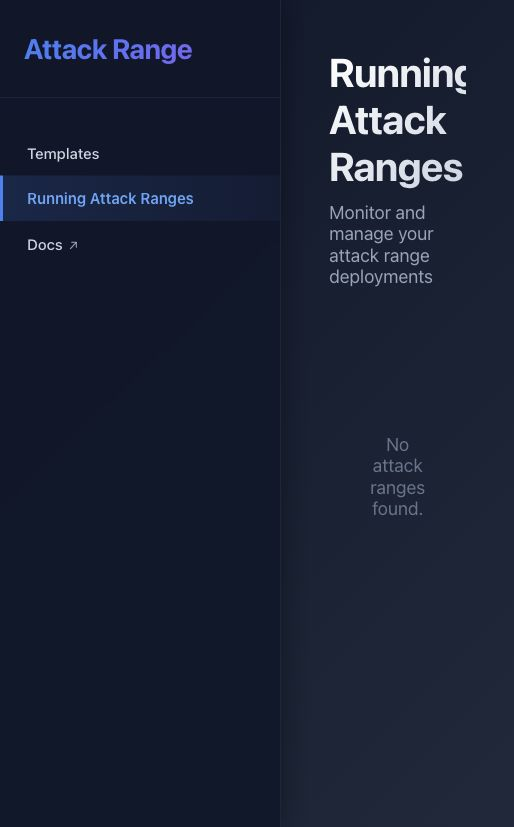

# Attack Range 관리 서비스 설치 확인 — 2026-10-10

공식 Splunk Attack Range의 커밋 `fc9b9e719d8835da0bbb5c20d46c52a9778d64e2`를 별도 비공개 경로에 내려받고 공식 Dockerfile로 API와 웹 UI를 빌드·기동했습니다. [설치·운영 명령](../attack-range.md)을 따릅니다. 기존 AegisLoop와 [실제 웹 실습 환경](purple-lab-ready-2026-10-10.md)은 유지했습니다.

## 실제 확인 결과

2026-10-10 22:58 KST에 설치된 서비스에 GET 요청을 실행했습니다.

| 항목 | 확인 결과 |
| --- | --- |
| API | `127.0.0.1:4000`, 컨테이너 healthy, `/health` healthy |
| 웹 UI | `127.0.0.1:4321`, 컨테이너 healthy, 템플릿·실습 목록 화면 확인 |
| 템플릿 | 공식 목록 23개 |
| 저장된 실습 설정·실습 서버 | 각각 0개 |
| OpenAPI | `/openapi/openapi.json` 정상, OpenAPI 3.1.0, 경로 20개 |
| Swagger UI | 공식 이미지의 `/openapi/swagger`는 404. 정상 제공되는 OpenAPI JSON으로 점검 |
| 클라우드 계정·서버 | 인증 미연결, 생성 0개, 시뮬레이션 실행 0회 |
| 자원 사용 | API 약 97 MiB, UI 약 92 MiB. 전체 제품·웹 실습·관리 컨테이너 약 3.8 GiB / Docker 할당 약 7.75 GiB |

API 메모리 한도는 1 GiB, UI는 512 MiB입니다. 두 서비스의 전용 네트워크만 만들었으며 호스트 Docker 소켓이나 기존 클라우드 인증 파일을 연결하지 않았습니다. 기존 제품의 데이터·LLM 연결 키를 복사하지 않았습니다.

## 빌드 식별자

| 이미지 | Docker image ID |
| --- | --- |
| API `aegis-attack-range-api:fc9b9e719d88` | `sha256:5c105051511ce7c17f499d9b385ea6f016926071a94b0fe946b58a04578ebd9a` |
| UI `aegis-attack-range-app:fc9b9e719d88` | `sha256:b4460d581ef54a6d35bf456e625cf001348b88ff4f9b56d15be4147b03a1ff27` |

상류 버전 문자열 혼재와 가변 다운로드가 있으므로 소스 커밋과 실제 이미지 ID를 함께 기록했습니다. 같은 커밋의 재빌드가 같은 이미지 바이트를 만들지는 않을 수 있습니다. 전체 설치·조회 집계는 Git 제외 경로 `.local-runtime/attack-range/installation.json`, `doctor.json`에 저장합니다.

## 실제 화면과 범위

템플릿 화면에서 공식 AWS Windows·Linux·AD 등의 구성을 확인했습니다. 아래 실습 목록은 비어 있습니다. **관리 화면 설치는 실제 Windows·Linux 서버 구축이나 공격·탐지 성능 확인의 증거가 아닙니다.**

AWS 실습은 하루 10달러 범위로 준비하고 있으나, 계정 SSO 연결·실제 Terraform 계획·종료 절차 확인 전에는 서버를 생성하지 않습니다. Windows 대상 테스트와 AegisLoop 로그 연결은 후속 단계입니다.
