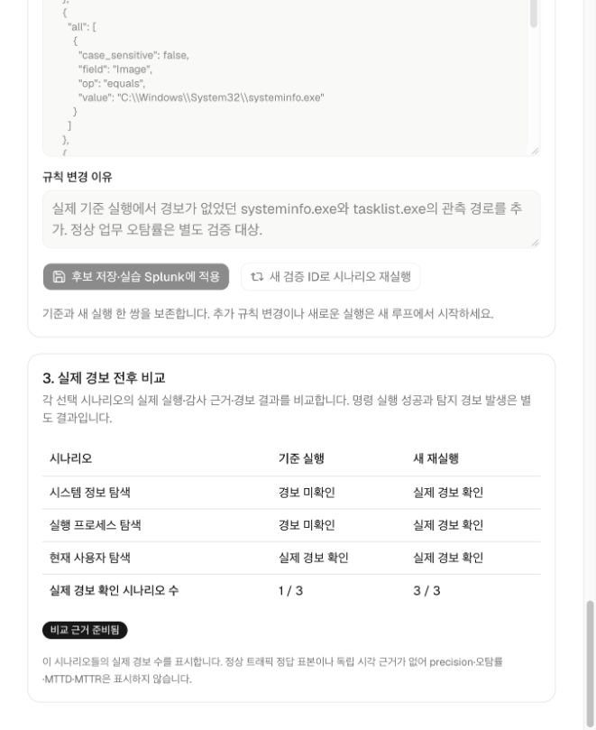

# AWS Windows 실제 Closed-loop 검증 — 2026-10-11

기존 소유 AWS Windows Server와 Splunk를 AegisLoop 웹의 **Closed-loop → AWS Windows 실습**에 연결하고, 브라우저에서 기준 실행·수집·후보 제안·규칙 적용·재실행·원본 내보내기를 수행했다.

| 실제 실행 기법 | 기준 규칙 | 개선 규칙 적용 후 새 실행 |
|---|---|---|
| 현재 사용자 탐색 — T1033 | 실제 경보 확인 | 실제 경보 확인 |
| 실행 프로세스 탐색 — T1057 | 경보 미확인 | 실제 경보 확인 |
| 시스템 정보 탐색 — T1082 | 경보 미확인 | 실제 경보 확인 |
| 경보가 확인된 시나리오 | **1/3** | **3/3** |

## 실행과 근거

- 최종 비교 사이클: `5a8cc2ff-2850-4b50-bfa3-ccc59011fd0d`, 후보 revision 2.
- 기준 실행: 2026-10-11 09:16:12–09:16:24 KST. 재실행: 09:19:59–09:20:12 KST.
- 각 실행에서 고정된 Atomic 세 개가 종료 코드 0으로 완료됐다. 서로 다른 실행 ID와 실제 Sysmon ProcessGuid 계보를 확인했다.
- 기준 규칙은 `whoami.exe`를 탐지했다. 후보는 기준 실행에서 관측된 `systeminfo.exe`와 `tasklist.exe` 경로 조건을 추가해 별도 실습 saved search에 실제 배포했다.
- 각 단계의 실제 예약 검색이 정상 완료되고 실행 시간 범위를 포함했음을 확인했다. 검색식·규칙 해시·호스트·ProcessGuid가 일치하는 실제 `logevent` 경보를 판정에 사용했다.
- `whoami /all`을 실행한 실제 Atomic 프로세스의 경보도 기준·재실행 각각에서 별도로 확인했다. 실행 모듈의 보조 프로세스가 로그에 포함되므로 이벤트 건수와 시나리오 수는 다르다.
- 양쪽 수집 모두 완전성 확인, 경고 0, 판정 불가 0이었다. 연결기를 재시작한 후에도 비교 결과와 이력이 유지됐다.
- 웹의 **근거 JSON 내보내기**로 2,438,027바이트의 원본 증거를 내려받아 검증했다. 이 최초 다운로드의 SHA-256: `2c9d3d94fca0f4ed366f6c26dab3232b630ae6f9892e9a74ab603fe0d3ee9f6f`. 내보내기 시각이 포함되어 재다운로드의 해시는 달라질 수 있다.

원본 Windows 로그와 관리 인증 정보는 공개 저장소에 포함하지 않는다. 원본은 로컬 `evidence-local/aws-windows-loop-2026-10-11/`에 보관하며, 공개 화면에는 계정·접속 키·공인 주소가 없다. 개발 중 발견한 규칙 배포 경로와 예약 검색 접두사 오류를 수정했고, 그 이전 실행은 최종 비교의 표본에서 제외했다.

## 검증 범위

이 결과는 고정된 **세 탐색 기법의 실습 경보 개선**을 보여준다. 정상 업무 표본이 없으므로 오탐률·정밀도나 기업 환경 전체의 탐지 성능을 입증하지 않는다. 취약점 악용 성공, 자격 증명 탈취, AD 횡적 이동, EDR 차단을 검증한 결과도 아니다.

관련 검증: 브리지·원본 귀속·예약 검색·인증·재시작 회귀 14개, Go 연결 API 회귀 6개, HTTP 규칙 도우미 회귀 9개 통과. 웹 정적 빌드와 TypeScript 검사를 통과했다.

설치와 사용 절차는 [AWS Windows 실습 가이드](../aws-windows-loop.md)를 참고한다.
