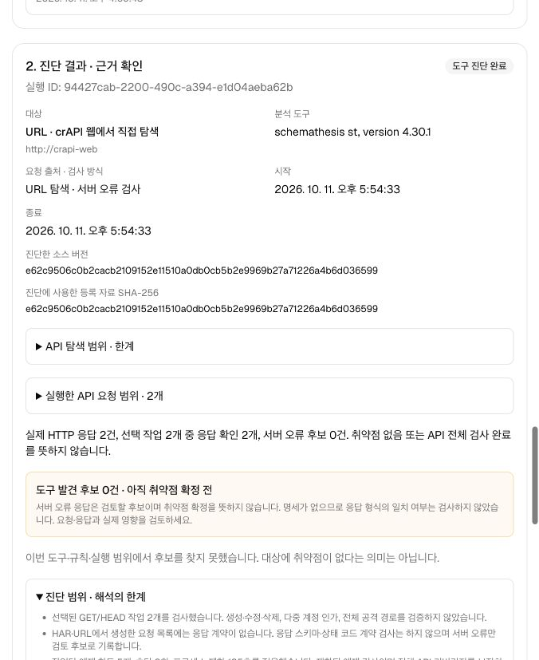
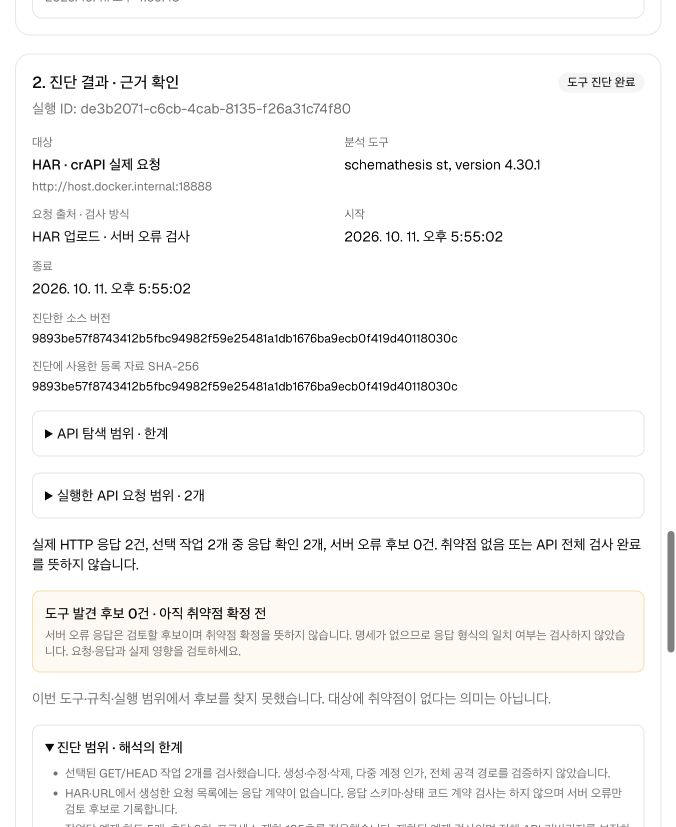

# URL · HAR API 진단 검증 · 2026-10-11

기존 OpenAPI 명세 업로드에 URL 탐색과 HAR 업로드를 추가했습니다. 이번 변경은 Offensive 대상 준비·도구 진단·ARTEX 검토 연결에 한정합니다.

## 실제 crAPI 확인

| 입력 | 확인 결과 |
|---|---|
| crAPI 홈페이지 URL | HTML과 연결된 JavaScript를 2회 조회하여 GET 후보 9개 발견. 정적 문자열 분석이며 API 전수 발견을 의미하지 않음 |
| 발견한 후보 중 GET 두 경로 선택, 일반 실습 계정 인증 | 실제 응답 2건 모두 HTTP 200, 서버 오류 후보 0건. 선택 경로와 응답 근거 일치 |
| 웹 URL 탐색 → 두 경로 선택 → 무인증 진단 | 웹에서 등록·실행·완료 확인. 실제 응답 HTTP 401 두 건, 인증 제한을 결과에 표시 |
| 웹 HAR 업로드 → 주소 연결 → 두 요청 진단 | 실제 crAPI 요청 기록에서 GET 두 개 추출. `localhost:18888` 기록을 `host.docker.internal:18888`에 연결하고 HTTP 401 두 건 확인 |

인증 검사는 내부 실행 API에서 시작했습니다. Bearer 토큰과 임시 계정 비밀번호는 메모리에서만 사용하며, 이번 검증에 새 LLM 호출은 포함하지 않았습니다.

- URL 등록 대상: `16465474-c868-4058-b294-1830bae6511b`
- 인증 진단 실행: `7e5827cb-44ee-4105-b882-45b1867018d8`
- 웹 URL 진단 실행: `94427cab-2200-490c-a394-e1d04aeba62b`
- 웹 HAR 진단 실행: `de3b2071-c6cb-4cab-8135-f26a31c74f80`
- 선택 경로: `GET /community/api/v2/community/posts/recent`, `GET /workshop/api/shop/products`
- 결과 근거 파일의 SHA-256 일치 확인.

URL/HAR에서 생성한 OpenAPI 문서는 **요청 목록**입니다. 응답 계약을 추정하지 않으며 `not_a_server_error` 검사만 실행합니다. 서버 오류 후보가 없다는 결과는 보안 취약점 없음이나 전체 API 검사 완료를 의미하지 않습니다.

## 실제 웹 화면

세 입력 방식과 HAR 원본 주소·실행 주소를 선택하는 화면입니다.

URL에서 발견한 후보 중 두 경로만 선택하여 검사한 실제 결과입니다.

실제 HAR 요청 기록을 업로드하고 진단한 결과입니다. 기록된 원본 주소로 접속하지 않고 등록한 실행 주소로 보낸 것을 출력 HAR에서 확인했습니다.

## 회귀 검증

- Go: 상위 테스트 229개 통과, 하위 항목 포함 380개.
- 실행기: 35개 통과. 기존 명세·소스 업로드와 함께 HAR 출처 연결·인증 정보 제외, 경로 제한, URL 탐색, DNS·연결·응답 시간 제한, 누적 본문 크기 제한 검증.
- 최종 앱·실행기 Docker 빌드 통과.
- 기존 ARTEX 작업이 실행 중인 동안 실행기를 먼저 적용하고, 앱 교체는 기존 작업 종료 이후 진행.

## 범위와 한계

- 사용자 선택 GET/HEAD만 실행하며 POST·PUT·PATCH·DELETE는 제외합니다.
- URL 탐색은 같은 출처·경로의 공개 HTML/정적 JavaScript를 분석합니다. 브라우저 스크립트 실행과 로그인 자동화는 포함하지 않습니다.
- HAR 원본 출처는 추출 조건이며 접속 대상이 아닙니다. 실제 요청은 등록한 실행 주소로만 보냅니다.
- 원본 HAR의 헤더·쿠키·쿼리 값·본문·응답 본문은 저장하거나 재사용하지 않습니다. 경로에 포함된 임의의 민감한 값은 업로드 전에 제거해야 합니다.
- 실제 등록 데이터·계정·원본 HAR·진단 이력은 Git에서 제외된 로컬 디렉터리에 보관하며 새 설치에 포함하지 않습니다.
