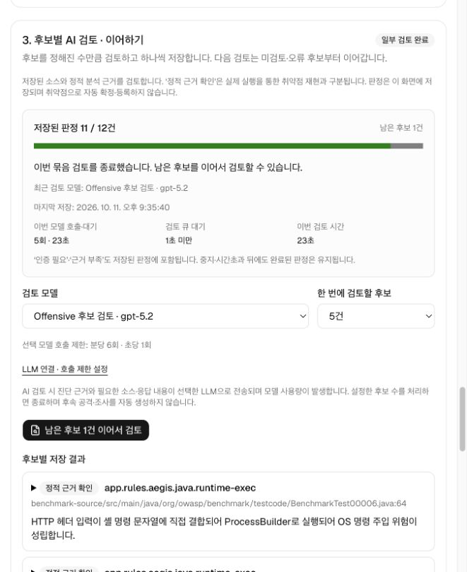
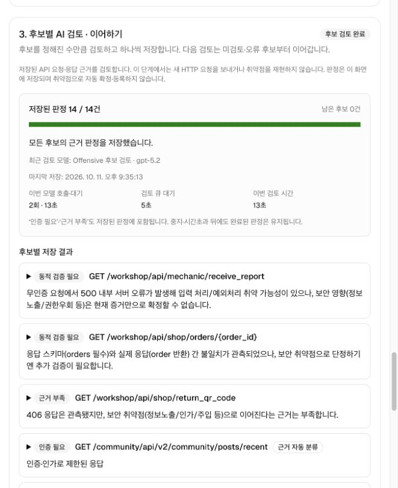
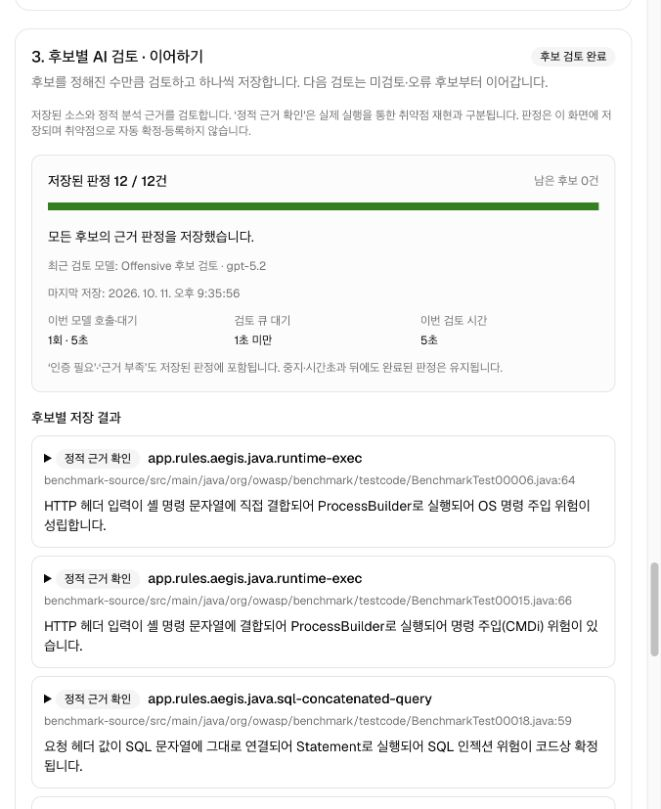
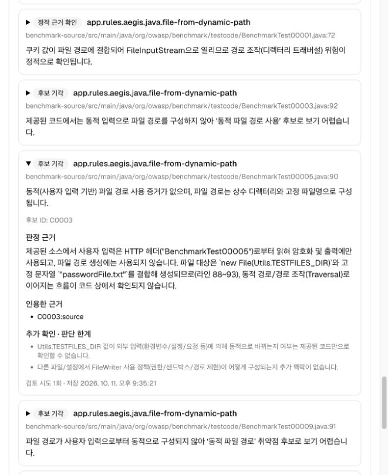

# API · 소스 후보별 검토와 이어하기 검증

2026-10-11, 실행 중인 로컬 ARTEX 웹에서 검증했습니다. 이전 ARTEX 검토 작업이 시간초과된 동일한 crAPI·Benchmark 도구 근거를 사용했습니다. 합성 응답이나 화면 목업이 아닙니다.

## 바뀐 흐름

도구 진단 → 후보별 근거 준비 → 한 건씩 AI 판정·즉시 저장 → 선택한 수만큼 처리 후 종료 → 남은 후보 이어하기.

- API·소스 후보 검토는 한 실행 큐를 사용하며 후보당 모델 호출은 한 번입니다. 별도의 Planner·최종 정리 호출을 만들지 않습니다.
- 한 번에 1~5건, 기본 3건을 처리합니다. 후보당 최대 300초이며 호출 오류가 나면 추가 호출 없이 해당 묶음을 종료합니다.
- 완료한 판정을 보존하고 미검토 후보부터 처리합니다. 오류 후보는 그다음 재시도합니다.
- 실제 저장 응답이 모두 401/403인 후보는 LLM 없이 인증·인가 제한으로 분류합니다. 안전 판정이나 인가 취약점 확정은 아닙니다.
- 새 판정은 후보 검토 화면에 저장합니다. 기존 ARTEX 작업 이력과 탐지·Splunk·침해 조사 기능은 유지합니다.

## 실제 결과

| 항목 | crAPI API | Benchmark 소스 ZIP |
|---|---|---|
| 기존 도구 근거 | 16개 작업·HTTP 응답 25건 | Java 소스 30파일 |
| 저장한 후보 판정 | 14 / 14건 | 12 / 12건 |
| 판정 내용 | 인증 필요 11, 동적 검증 필요 2, 근거 부족 1 | 정적 근거 확인 5, 후보 기각 7 |
| 실제 모델 호출 | 3회 | 12회 |
| 누적 모델 호출·대기 | 약 20초 | 약 63초 |
| 입력 / 출력 토큰 | 6,610 / 1,304 | 27,915 / 4,118 |
| 후보별 모델 검토 횟수 | 자동 분류 0회, 나머지 각각 1회 | 각각 1회 |

이번 로컬 검토 전용 프로필은 `gpt-5.2`, reasoning `low`, 출력 최대 3,000토큰, RPM 6·RPS 1이었습니다. 기존 기본 모델 설정은 바꾸지 않았습니다. 이 설정은 공개 설치의 고정값이 아니며 사용자가 웹에서 프로필을 선택합니다.

시간은 공급자 호출 제한 대기를 포함한 모델 함수의 누적 측정값입니다. 사용자가 이어하기를 누르기까지의 시간과 다른 묶음을 기다린 큐 시간은 제외합니다. 모델·입력·검토 방식이 바뀌었으므로 기존 시간초과 실행과의 엄격한 성능 비교 실험은 아닙니다.

## 웹에서 확인한 동작

1. API는 11건 자동 분류 후 1건만 모델로 검토해 **12 / 14건**에서 종료했습니다.
2. 소스는 **1 / 12건**에서 종료했습니다. 페이지를 새로고침하고 각 실행 이력을 다시 선택해 저장된 판정을 확인했습니다.
3. 소스의 다음 5건을 검토하는 동안 API 이어하기는 큐에서 기다렸습니다. API를 중지했을 때 저장된 12건은 유지됐고 해당 대기 실행의 모델 호출은 0회였습니다.
4. API를 다시 이어서 나머지 2건을 완료했습니다. 소스는 `1 → 6 → 11 → 12건` 순서로 마쳤습니다. 완료 후보의 모델 호출 횟수는 늘지 않았습니다.
5. 최종 앱 재시작 후에도 소스 12건의 완료 판정이 복원됐습니다. 후보를 펼쳐 기각 사유·인용 근거·판단 한계를 확인했습니다.

## 판정의 한계

API 검토는 저장된 요청·응답을 해석하며 새 요청이나 계정 간 비교를 실행하지 않습니다. 500 응답과 응답 스키마 불일치는 추가 동적 검증이 필요한 후보로 남겼습니다.

소스는 해시를 확인한 제한된 코드 문맥의 정적 검토입니다. 정적 근거 확인 5건은 실행 환경에서의 악용 성공을 뜻하지 않으며, 기각 7건도 프로젝트 전체가 안전하다는 뜻이 아닙니다. 이 기록은 검토·저장·이어하기 기능 검증이며 정답 데이터셋 전체를 채점한 Precision·Recall 결과가 아닙니다.

실행 중 호스트 시각이 뒤로 조정되어 한 묶음의 벽시계 경과가 모델 측정 시간보다 짧게 기록됐습니다. 후속 수정은 단조 시계로 실행 시간을 측정하고, 취소·복구·기존 이력 표시의 경과가 확인된 모델 시간보다 짧아지지 않도록 했습니다. 과거 DB 원본 시각은 변경하지 않았습니다.

## 검증 자료

- [인증값·원본 코드·응답 본문을 제외한 실제 결과 요약](offensive-candidate-review-results-2026-10-11.json)
- 최종 Docker 회귀 테스트 **252개 통과**(하위 테스트 포함 444개, 실패 0개). 프런트엔드 TypeScript·Biome 검사와 앱의 정적 웹/Go 빌드도 통과했습니다. 기존 cookie 관련 lint 경고 1건은 변경 범위 밖에 남아 있습니다.
- 자동 회귀에는 API·소스의 유한 종료, 이어하기, 중복 시작, 취소 후 늦은 응답, 오류 후 종료, 실행 큐, 중단 복구와 근거 무결성 검증을 포함합니다. 모델 호출은 자동 테스트에서 대역을, 위 웹 검증에서는 실제 설정한 모델을 사용했습니다.
- [웹 사용 순서](../USER_GUIDE_KO.md#api--소스-코드-진단하기) · [상세 안내](../offensive-assessments.md)

실행 데이터와 인증 정보는 로컬에만 보관하며 새 설치에 포함하지 않습니다.
