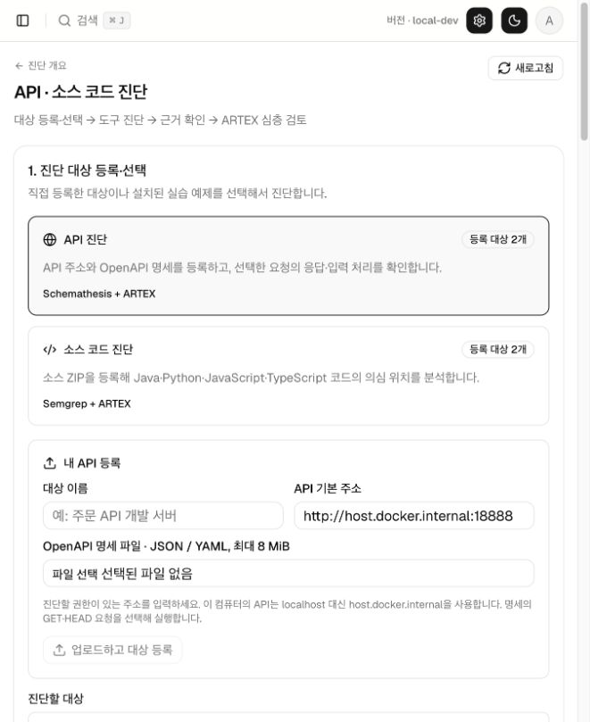
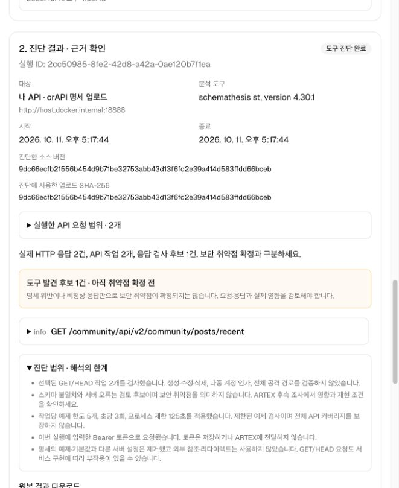
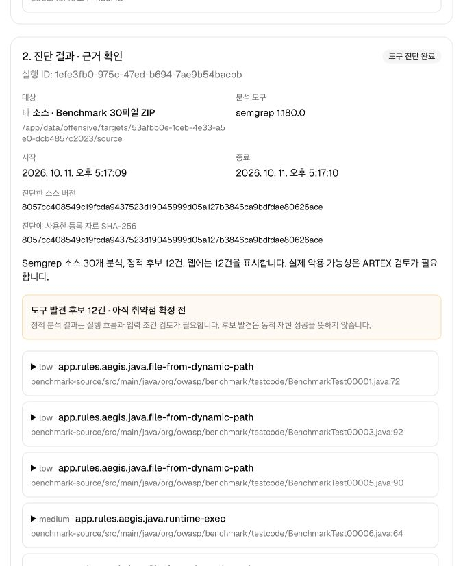

# 사용자 업로드 진단 검증 · 2026-10-11

고정된 예제 외에 사용자 API 명세·소스 ZIP을 등록하고 선택해서 진단할 수 있는지 확인했습니다. 기존 탐지·Splunk·Defensive·Closed-loop 구현은 변경하지 않았습니다.

## 실제 실행

| 검증 | 입력·범위 | 확인 결과 |
|---|---|---|
| 웹 API 업로드 | 공식 crAPI OpenAPI JSON, 사용자가 입력하는 주소 `http://host.docker.internal:18888`, GET 두 경로 선택 | 웹 등록·진단 완료. 무인증 요청은 두 경로 모두 401. 인증 한계를 결과에 표시 |
| 동일 API 인증 재검사 | 등록한 같은 대상·같은 두 경로, 임시 실습 계정 Bearer 인증. 내부 실행 API에서 시작하고 웹 이력·결과 확인 | 두 경로 모두 200, 응답 검사 후보 1건. 토큰 마스킹·근거 SHA-256 검증 |
| 웹 소스 업로드 | 공식 Benchmark Java에서 가져온 실제 소스 30개를 ZIP으로 등록 | 30파일 분석, 정적 후보 12건, 웹 표시 및 근거 해시 검증 |

선택한 API 경로는 `/community/api/v2/community/posts/recent`와 `/workshop/api/shop/products`입니다. HAR에서 이 두 경로에만 GET 요청한 것을 확인했습니다. 후보는 확정 취약점이 아니며, 이번에는 별도 유료 LLM 심층 검토를 실행하지 않았습니다.

- API 무인증 실행: `c1eb5af7-3b28-4ce5-8d83-549e2338fba8`
- API 인증 실행: `2cc50985-8fe2-42d8-a42a-0ae120b7f1ea`
- 소스 실행: `1efe3fb0-975c-47ed-b694-7ae9b54bacbb`

실제 입력과 결과는 로컬의 Git 제외 디렉터리에 보관합니다. 사용자 소스·토큰·DB·실습 계정은 공개 배포에 포함하지 않습니다.

## 웹 화면

## 구현 검증

- Go 회귀 테스트: 상위 테스트 225개 통과(하위 항목 포함 362개).
- 실행기 테스트: 21개 통과. ZIP 경로·링크·중복·용량 제한, YAML 복잡도·외부 참조, 범위 선택, 토큰 비보존, 업로드 무결성, 실제 Java/Python/JS/TS Semgrep 실행 포함.
- 최종 웹 빌드와 TypeScript 검사 통과.
- 업로드 소스가 ARTEX 컨테이너에 읽기 전용으로 연결된 것을 확인.
- API와 소스의 새 결과에서 모든 근거 파일 SHA-256 일치 확인.

API 진단은 현재 GET/HEAD에 한정합니다. 소스 진단은 제한된 로컬 규칙에 따른 정적 후보 수집이며, 모든 언어·취약점 유형·동적 악용·정량 정확도를 검증한 것은 아닙니다.
