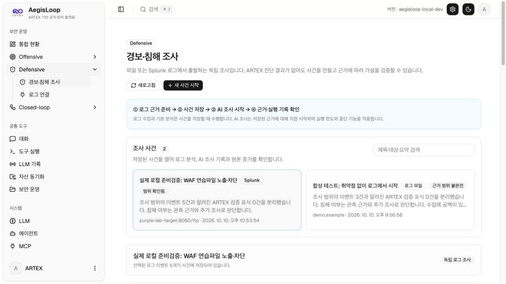

# 실제 로컬 환경 준비 확인 — 2026-10-10

## 실행 환경

2026-10-10 22:50~22:54 KST에 기존 Juice Shop·ModSecurity/OWASP CRS WAF·Splunk·로그 수집기를 다시 실행하고 실제 로컬 요청과 Splunk 경보를 확인했습니다. AegisLoop와 PostgreSQL은 기존 데이터·키·설정을 유지했습니다. 기존 약관 수락 기록을 사용했으며 새 약관에 동의하거나 클라우드 자원을 만들지 않았습니다.

| 구성 | 확인 결과 |
| --- | --- |
| AegisLoop | 기존 앱 실행 유지, 기존 검색 연결 테스트 성공 |
| Juice Shop·WAF | 실행 중, 대상은 WAF 앞단 `http://purple-lab-target:8080` |
| Splunk | 실행 중, 검색 전용 계정으로 조회 가능, 저장된 정확한 TLS 인증서 핀 일치 |
| 로그 수집기 | 정상·HEC 정상, 미전달 큐 0건 |
| 접근 범위 | 기존 `artex-purple-lab-front` 연결 복원, 웹 포트는 기존 localhost 바인딩 유지 |
| 라이선스 | 기존 Enterprise Trial `VALID`, 만료 2026-12-09 14:11:45 KST |

확인 시점에 Splunk가 약 3.02 GiB, 제품과 실습 컨테이너 6개가 합계 약 3.35 GiB를 사용했습니다. Docker 메모리 할당은 약 7.75 GiB입니다. 사용량은 실행 중인 검색·수집량에 따라 달라집니다.

## 실제 요청·탐지·차단

`./scripts/purple-lab.sh check`가 각 구간에서 정상 `/` 요청, 고정 연습파일 `/ftp/acquisitions.md` 접근, CRS SQLi 패턴 요청을 각각 1회 실행했습니다. 합계 9회 요청의 실제 native 감사 로그 9건과 Splunk saved search가 만든 실제 경보 4건을 확인했습니다.

| 실제 구간 시작(KST) | WAF 정책 | 실제 감사 | 실제 경보 | 고정 연습파일 응답 |
| --- | --- | ---: | ---: | --- |
| 22:50:17 | 탐지 전용·허용 | 3 | 2 | HTTP 200, 909바이트 전체 전달 |
| 22:51:10 | 실제 차단 | 3 | 2 | HTTP 403, 원본 파일 미전달 |
| 22:52:09 | 탐지 전용·경보 비활성 | 3 | 0 | HTTP 200, 909바이트 전체 전달 |

파일 노출은 HTTP 200만으로 판단하지 않았습니다. 고정 Juice Shop 컨테이너의 `/juice-shop/ftp/acquisitions.md`를 읽어 바이트 수·SHA-256을 확인한 뒤 실제 HTTP 응답과 대조했습니다. 허용 구간은 전체 파일이 일치했고, 차단 구간은 파일 바이트가 일치하지 않았으며 WAF 감사 로그에 명시적 `blocked` 조치가 남았습니다. 파일 본문은 공개 기록에 넣지 않았습니다.

CRS의 SQLi 규칙 일치와 차단도 확인했습니다. 패턴 탐지는 SQLi 악용 성공을 의미하지 않습니다. 이 검사는 로컬의 의도적으로 취약한 연습파일 접근을 확인한 것으로 기업 데이터 유출을 주장하지 않습니다. WAF 차단은 앞단 정책의 효과이며 Juice Shop 취약 코드 수정의 증거는 아닙니다.

경보 비활성 사례는 수집·판정 경로를 확인하는 음성 대조입니다. 실제 미탐 성능이나 규칙 개선 효과의 평가 자료로 사용하지 않습니다. 다음 성능 검증에서는 경보를 켠 상태에서 정상 활동과 실제 미탐 행위를 수집하고 새로운 실행으로 재검증해야 합니다.

종료 후 WAF를 `DetectionOnly`, Splunk 경보를 `on`으로 복원했습니다.

## AegisLoop의 실제 로그 조사 준비

기존 Splunk 검색 연결을 사용해 **실제 로컬 준비검증: WAF 연습파일 노출·차단** 사건을 저장했습니다. [로컬 사건 열기](http://localhost:8787/defensive/?case=2)

| 항목 | 확인 결과 |
| --- | --- |
| 사건 | 로컬 사건 2번, 기존 취약점 연결 없이 생성 |
| 조회 대상·경로 | `purple-lab-target:8080`, `/ftp` |
| 조회 기간 | 2026-10-10 22:50:03~22:53:52 KST |
| 실제 선택 근거 | 감사 3건·경보 2건, 합계 5개 이벤트 |
| 조회 상태 | 조회 완료, 행·바이트 한도 초과 없음 |
| 원본 보존 | 내보내기 원본 파일 2개 모두 저장된 SHA-256과 일치 |
| AI 실행 | 0회, 유료 모델 호출 없음 |

사건에는 두 가지 경고가 그대로 남습니다. 조회 완료가 원본 시스템의 수집·보존 범위를 보증하지 않으며, 독립 환경 검사에서 만든 UUID는 등록된 ARTEX 재검증 실행이 아닙니다. 해당 표식을 실제 외부 침해의 증거로 해석하거나 다른 ARTEX 실행의 근거로 대신 제출하지 않습니다. 원본 감사 로그만으로 응답 본문 전달 완료를 추정하지 않으며, 파일 전달 확인은 위의 별도 바이트·SHA-256 대조 기록을 사용합니다.

브라우저에서도 같은 사건의 실제 Splunk 근거 5개와 AI 미실행 상태를 확인했습니다. 캡처에는 비밀번호·토큰을 포함하지 않았습니다.



## 보존·재현

기존 제품 환경 파일·JWT 키, Splunk 관리자·검색 계정 파일, HEC 토큰, 관리 API·HEC 인증서 핀 등 7개 파일의 해시가 변경되지 않았습니다. 수집·TLS 관련 Python 테스트 42개와 실제 환경 검사가 통과했습니다.

```sh
./scripts/purple-lab.sh start
./scripts/purple-lab.sh connect
./scripts/purple-lab.sh check
./scripts/purple-lab.sh status
```

원문 감사 로그, 실제 실행 식별자, 전체 검사 기록, 사건 원본은 Git에서 제외된 `evidence-local/purple-lab/`에 보존합니다. 인증 정보는 `.local-runtime/purple-lab/`에 남기며 GitHub에 포함하지 않습니다. 이 문서는 실제 준비 상태의 공개 요약이며 [기존 실습 가이드](../purple-lab.md)와 함께 사용합니다.
