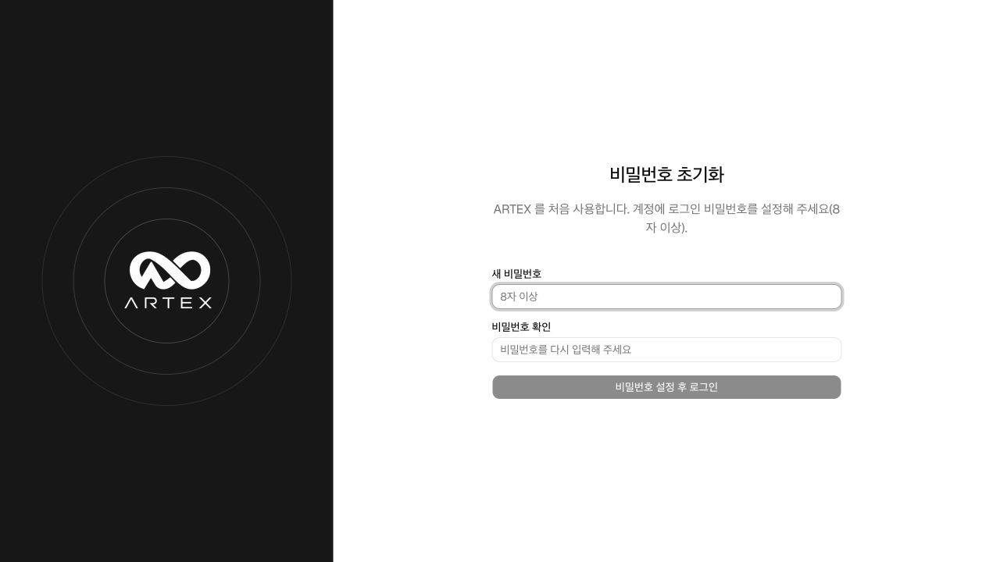

# API 진단 확장 포함 배포 검증 · 2026-10-11

명세·URL·HAR API 진단과 소스 ZIP 분석을 포함한 소스 배포본입니다. 기존 진단·방어·조사 기능과 공개 증적을 유지하며, 최신 화면을 README와 [사용 가이드](../USER_GUIDE_KO.md)에 추가했습니다.

## 공개 증적

실행 중인 로컬 앱에서 입력 선택 화면, 기존 URL·HAR 완료 결과와 Benchmark 소스 분석 결과를 다시 캡처했습니다. 새 공격·스캐너·모델 호출 없이 저장된 결과를 사용했습니다. 캡처에는 API 키·인증 토큰·개인 계정 정보가 없습니다.

실제 검증 범위는 [URL·HAR 진단 기록](offensive-api-discovery-validation-2026-10-11.md)과 [명세·소스 ZIP 기록](offensive-upload-validation-2026-10-11.md)을 참고하세요. 도구 후보, 인증 제한, 확정 취약점을 구분합니다. URL·HAR의 후보 0건은 대상에 취약점이 없다는 뜻이 아닙니다.

## 배포 구성

- 현재 저장된 소스·문서·이미지·실행 스크립트와 새 미추적 파일을 포함합니다.
- `.git` 이력, 실제 환경 파일·키·토큰, `data/`, `.local-runtime/`, DB·볼륨, 원본 HAR·로그·사용자 소스 ZIP은 제외합니다.
- 설명용 `.env.example`과 실제 접근 권한이 없는 테스트 픽스처는 포함합니다.
- crAPI·Benchmark 공식 소스는 설치 시 지정 커밋을 내려받습니다. 개발자의 실습 데이터나 계정은 포함하지 않습니다.
- 기본 앱 설치는 ARTEX·PostgreSQL만 시작합니다. API·소스 진단 실행기는 `offensive-start.sh`로 별도 준비하며, Juice Shop·Splunk·AWS는 기본 설치에 포함되지 않습니다.

소스 폴더의 `SOURCE_MANIFEST.sha256`과 ZIP 옆의 `.zip.sha256`으로 파일 무결성을 확인할 수 있습니다. 이 배포 작업은 GitHub 커밋·푸시를 하지 않습니다. 기존 GitHub 저장소의 과거 이력은 이번 소스 압축 검사 대상과 별개입니다.

## 이번에 확인한 항목

| 검증 | 결과 |
|---|---|
| 공개 소스만 복사한 별도 Docker 설치 | UI·Go 빌드와 ARTEX·PostgreSQL 기동 성공, health 응답 정상 |
| 최초 접속 | 관리자 비밀번호 미설정 상태(`initialized: false`), 초기 설정 화면 확인 |
| 새 DB | LLM 연결·로그 연결·작업·취약점·Defensive 사건·침해 조사·실행 루프 기록 모두 0건 |
| 진단 실행기 | 공개 소스에서 이미지 빌드 성공, 외부 네트워크 없이 실행기 테스트 35개 통과 |
| 배포 패키저 | 비밀 경로 제외·새 파일 포함·해시·권한·덮어쓰기 방지 등 테스트 8개 통과 |
| 비밀 탐지 | Gitleaks 8.30.1 검사 결과 7건을 검토해 테스트 픽스처·고정 커밋 SHA·빈 환경 변수 예시로 확인, 실제 인증값 발견 없음 |
| 로컬 인증값 대조 | 로컬 DB 비밀번호·JWT 키·진단 서비스 인증값 등 4개를 출력 없이 대조, 배포 파일과 일치 0건 |
| 문서 참조 | 미추적 문서를 포함한 Markdown 87개 검사, 깨진 파일·이미지·앵커 참조 0건 |

새 설치는 기존 서비스와 분리된 프로젝트·포트·빈 DB를 사용했습니다. 확인 후 검사 전용 컨테이너와 빈 볼륨을 정리했습니다. 기존 사용 환경과 실습 데이터는 유지했습니다.

API·소스 확장 당시의 Go 회귀 검사 229개(하위 항목 포함 380개)와 실제 crAPI·Benchmark 실행은 앞의 기능별 검증 기록에 있습니다. 이번 배포 검사는 별도 crAPI·Benchmark 묶음이나 AWS 환경을 다시 띄우거나 실제 LLM을 호출한 검증은 아닙니다.
