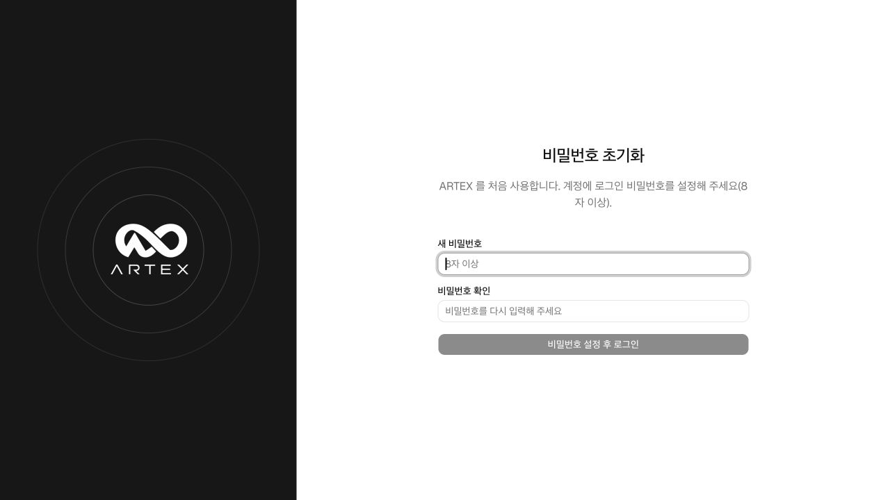

# 후보별 AI 검토 포함 소스 배포 검증 · 2026-10-11

배포명: `aegisloop-public-20261011-candidate-review`

API·소스 후보별 검토, 즉시 저장, 유한 종료, 중지·이어하기와 실제 캡처를 포함한 소스 배포본입니다. 기존 탐지·Splunk·Defensive·Closed-loop 기능은 이번 재포장에서 변경하지 않았습니다.

## 포함한 내용

- 최신 애플리케이션 소스·테스트·Docker 구성과 실행 스크립트.
- README, [사용 가이드](../USER_GUIDE_KO.md), 후보별 검토 화면 4장과 [실제 모델 검증 기록](offensive-candidate-review-validation-2026-10-11.md).
- crAPI API 후보 14건, Benchmark 소스 후보 12건의 판정·호출 수를 담은 인증값 없는 공개 요약.
- 원본·한국어판 저작권 표시와 AGPL-3.0 라이선스.

실제 API 키·로그인 정보·LLM 프로필·JWT 키·AWS/Splunk 연결값, `.env.local`, `.local-runtime/`, `data/`, 원본 HAR·소스 ZIP·운영 DB·로그와 Git 이력은 제외합니다. 공개 화면 속 실행 기록이 새 설치에 적재되지는 않습니다.

## 깨끗한 복사본 검증

실제 패키저가 만든 ZIP의 공개 소스만 별도 임시 폴더에 복사했습니다. 기존 앱과 다른 Docker 프로젝트·이미지·포트·빈 DB로 실행했으며 개발 폴더의 인증값이나 볼륨은 연결하지 않았습니다.

| 항목 | 확인 결과 |
|---|---|
| 기본 앱 | 공개 소스의 정적 웹·Go 빌드와 ARTEX·PostgreSQL 기동 성공, health 정상 |
| 최초 접속 | 관리자 비밀번호 미설정(`initialized: false`), 초기 설정 화면 확인 |
| 새 DB | LLM·로그 연결, 작업·취약점, Defensive 사건·조사·실행 루프·후보 검토 모두 0건 |
| 배포 소스 회귀 검사 | 252개 통과, 하위 테스트 포함 444개, 실패 0개 |
| 선택형 진단 실행기 | 공개 소스 이미지 빌드 및 외부 통신 없는 테스트 35개 통과 |
| 패키저 | 비밀 경로 제외·미추적 파일 포함·권한·해시·덮어쓰기 방지 등 8개 테스트 통과 |
| 로컬 인증값 대조 | 저장된 LLM 키를 포함한 인증값 5개를 출력 없이 대조, 일치 파일 0개 |
| 비밀 탐지 | Gitleaks 기본 규칙의 경고 7개 모두 가상 테스트 문자열 5개·고정 Git 커밋 해시·빈 환경 변수 예시로 확인. 실제 인증값 발견 없음 |
| 문서·패키지 | 문서 내부 파일·이미지·앵커, 소스 manifest 및 ZIP 무결성 확인 |

새 설치 검증에서는 관리자 비밀번호·LLM·Splunk를 설정하거나 새 진단·모델 호출을 실행하지 않았습니다. 실제 모델에 연결한 기능 검증은 앞의 후보별 검토 기록과 구분합니다. 검사 후 검증 전용 컨테이너와 빈 볼륨만 정리했으며 기존 사용자 환경은 유지했습니다.

## 사용과 배포

소스 폴더의 `SOURCE_MANIFEST.sha256`과 ZIP 옆의 `.zip.sha256`으로 무결성을 확인할 수 있습니다. 기존 GitHub 저장소에는 **폴더 안의 내용과 숨김 파일**을 반영하고 기존 `.git`은 유지합니다. 커밋·푸시는 저장소 소유자가 직접 진행합니다. 이번 ZIP 검사는 대상 GitHub 저장소의 과거 이력까지 검사한 것은 아닙니다.

새 사용자는 Docker 실행 후 `./scripts/local-start.sh`를 실행하고 초기 관리자 비밀번호와 본인의 LLM 연결을 설정합니다. 기본 설치는 ARTEX·PostgreSQL이며 Juice Shop·Splunk·AWS 서버를 만들지 않습니다. API·소스 실행기는 `./scripts/offensive-start.sh`로 별도 준비합니다. [전체 배포 안내](../release.md)를 참고하세요.
