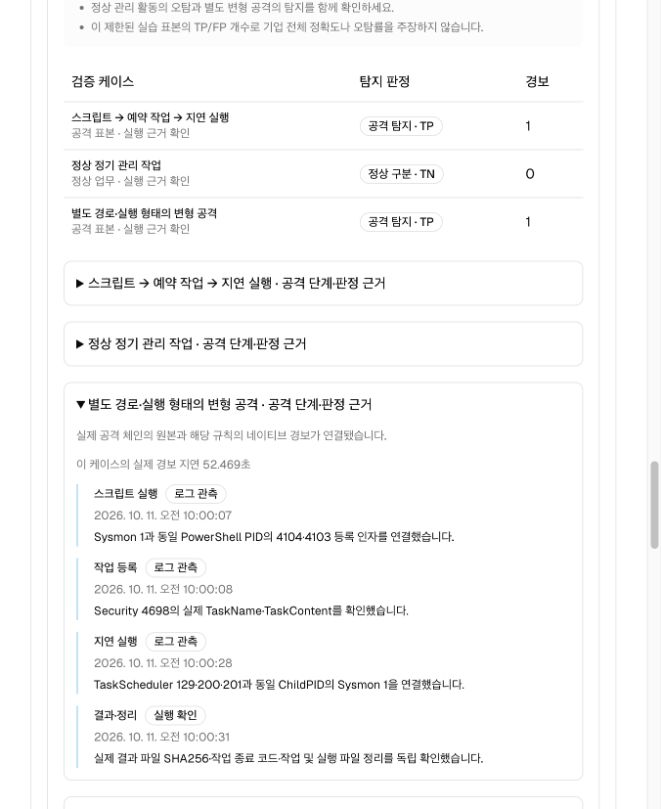

# Windows 예약 작업 체인 검증 기록 — 2026-10-11

기존 소유 AWS Windows와 실습 Splunk를 AegisLoop 웹의 **Closed-loop → AWS Windows 실습**에 연결해, 공격·정상 활동의 실제 근거를 검토하고 탐지 규칙을 개선하는 흐름을 확인했다. 이 기록은 PowerShell → 예약 작업 등록 → 지연 실행 체인에 대한 증적이다.

**공통 공격은 개선 전후 모두 탐지됐고, 정상 업무 오탐은 1건에서 0건으로 줄었다. 별도 변형 공격도 탐지됐다.** 기준과 개선 후 실행 모두 실제 로그·Splunk 경보 수집을 완료했으며 판정 불가 표본은 없다. 이는 아래 제한된 실습 표본의 결과다.

두 화면은 저장된 실제 검증 기록을 2026-10-11에 웹에서 다시 열어 캡처했다. 첫 화면은 공통 표본의 전후 비교와 별도 변형 판정, 두 번째는 변형의 PowerShell·작업 등록·지연 실행·결과 정리 근거를 보여준다. 캡처를 위해 공격을 다시 실행하지 않았다.

## 환경과 검증 표본

- 기존 실습 Windows, Splunk Universal Forwarder, 실습 Splunk와 선택형 실행 브리지를 사용했다. 이번 체인 검증을 위해 새 AWS 서버나 IAM 권한을 만들지 않았다.
- 웹은 고정된 체인 묶음 `ps_task_chain`을 실행한다. 기존 Atomic 탐색 시나리오와는 별도 실행이며, 임의 명령·임의 대상 입력 기능은 없다.
- 기준 실행의 공통 표본은 공격 체인 `chain_attack` 1건과 정상 관리 작업 `chain_benign` 1건이다.
- 개선 재실행은 같은 종류의 공통 표본 2건을 새로 실행하고, 별도 변형 공격 `chain_variant` 1건을 추가한다. 변형은 다른 작업 경로·스크립트 이름·실행 인자를 사용하는 미리 정의된 검증 사례다.
- 작업은 무해한 결과 파일을 작성한다. 실행 결과·파일 해시·작업 종료 코드와 작업·결과 디렉터리 정리를 확인한다.

후보 제안에는 기준 실행의 로그만 사용한다. 변형 공격은 후보 적용 후 처음 실행하며, 공통 표본의 전후 지표에 변형 표본을 섞지 않는다.

## 실제 근거의 연결

| 근거 | 확인하는 연결 |
|---|---|
| Sysmon 1 | 실제 PowerShell 시작 프로세스와 ProcessGuid |
| PowerShell 4104·4103 | 시작 프로세스의 PID, 스크립트 블록, 실제 `Register-ScheduledTask` 작업 이름 파라미터 |
| Security 4698 | 해당 작업의 등록과 TaskContent 실행 파일·인자·작업 디렉터리 |
| TaskScheduler 129·200·201 | 같은 작업의 지연 실행 PID, 동작 시작과 정상 완료 |
| Sysmon 1·11 | 실행 PID에 해당하는 후속 프로세스의 ProcessGuid와 실제 결과 파일 생성 |
| 실습 Splunk 경보 | 원격 규칙 ID·규칙 SHA-256·ProcessGuid·원본 시각이 해당 실행과 일치하는 네이티브 경보 |

규칙은 실제 Splunk 예약 검색으로 실행하고 `logevent` 경보를 수집한다. 예약 검색의 정상 완료·실행 전체 시간 범위·입력 한도도 확인한다. 단순히 검색 결과가 비었다는 사실만으로 공격 미탐이나 정상 무경보를 계산하지 않는다. 로그 누락·실행 실패·객체 연결 부족·상충하는 ProcessGuid는 **판정 불가**로 남긴다.

실행 UUID·작업 이름·전용 파일명은 해당 시험의 근거를 연결하는 데만 사용한다. 탐지 규칙의 조건에는 넣지 않는다. 기준 실행과 개선 재실행은 서로 다른 실행 ID·시각·실제 프로세스 근거를 사용한다.

## 수집 보완과 이전 판정 불가

초기 시험에서는 실행 결과를 확인했더라도 결과 파일의 Sysmon 11 근거가 빠져 체인 판정을 확정하지 못했다. 기존 Sysmon 필터가 PowerShell의 JSON 결과 파일 생성을 수집하지 않았고, Windows의 짧은 경로와 원본 로그의 긴 경로 표현이 달라 파일 연결에도 차이가 있었다.

다음 보완 후 **새 기준 실행**을 시작했다.

- 활성 Sysmon 설정의 경로와 SHA-256을 확인하고 원본 XML을 보존했다. 기존 XML에 PowerShell의 JSON 파일 생성 수집 조건을 추가했다. 이는 공격·정상 작업에 동일하게 적용하는 감사 수집 조건이다.
- 실행 작업 디렉터리와 결과 파일 경로를 Windows의 긴 경로로 정규화해 실제 파일 생성 로그와 연결했다.
- TaskScheduler 채널·전달 입력, 예약 작업 등록 성공 감사, ScheduledTasks 모듈 로깅을 준비했다. 이전 감사·모듈 설정과 입력 설정을 보존했다.

보완은 이미 끝난 실행의 빠진 로그를 소급 생성하지 않는다. 이전 판정 불가 실행은 아래 확정 기준 결과의 표본에서 제외했다. 같은 실행의 늦은 원본 재수집은 허용하지만 공격을 자동으로 다시 실행하지 않는다.

## 확정된 전후 결과

확정 기준 사이클은 `a64f7748-131c-400f-a0d8-85e4b3438d3d`다. 이 기록에는 대상 IP·계정·호스트 이름·관리 인증 정보를 포함하지 않는다.

| 공통 표본 | 기준 규칙의 실제 판정 | 개선 재실행 판정 |
|---|---|---|
| 공격 체인 1건 | TP: 실제 네이티브 경보 확인 | TP: 새 프로세스에 대한 후보 규칙 경보 확인 |
| 정상 관리 작업 1건 | FP: 정상 활동에도 실제 경보 발생 | TN: 실제 정상 실행·수집 완료·후보 경보 없음 |
| 공통 표본 지표 | **TP=1, FN=0, FP=1, TN=0, 판정 불가=0** | **TP=1, FN=0, FP=0, TN=1, 판정 불가=0** |

별도 변형 `chain_variant`는 새 실행에서 **TP 1건**으로 확인됐다. 개선 후 전체 세 표본을 합하면 TP=2, FN=0, FP=0, TN=1이지만 공통 표본 전후 비교에는 변형을 합산하지 않았다.

기준 규칙 `powershell_broad`는 PowerShell 프로세스 실행을 넓게 탐지했다. 공격 체인을 탐지했지만 정상 작업도 경보로 분류했다. 기준 실행의 원본 상관 근거와 수집 완전성을 확인한 뒤 이 오탐을 개선 근거로 삼았다.

## 후보 적용과 새 검증

기준 로그의 근거를 검토하고 변경 이유를 기록한 뒤, `task_behavior` 프로파일을 실습 Splunk에 실제 적용했다. 후보 적용 완료 revision은 **2**다.

후보는 단순 PowerShell 실행에서 작업 등록·의심스러운 실행 인자·쓰기 가능한 작업 디렉터리·실제 지연 실행의 다중 로그 상관 조건으로 바뀐다. 제안 설명과 검토 기록, 규칙·원격 적용 근거는 이력에 보존한다. 기준 로그가 불완전하거나 공통 표본이 판정 불가이면 직접 API 요청으로도 후보를 적용할 수 없다.

새 재실행은 2026-10-11 09:59:10~10:00:31 KST에 진행했다. 세 작업 모두 종료 코드 0, 독립 결과 파일 해시, 실제 로그 연결, 예약 작업·결과 디렉터리 정리를 확인했다. 최종 수집은 150초의 경보 관측 구간 후 완료했다.

| 수집 근거 | 기준 | 개선 후 |
|---|---|---|
| 실행 ID | `338a5cb7-33c3-4346-83c3-e0bcbf415cff` | `9b3928c0-1330-4331-acf8-88db5d08ac7e` |
| 웹에 표시된 상관 감사 근거 | 24건 | 36건 |
| 해당 실행에 귀속된 실제 경보 | 4건: 공격 2, 정상 2 | 2건: 공격 1, 변형 1, 정상 0 |
| 수집 범위 | complete, 경고 없음 | complete, 경고 없음 |
| 판정 불가 | 0건 | 0건 |

위 경보 건수는 표본 판정 수와 다르다. 기준 규칙은 체인의 시작·후속 PowerShell에 각각 경보를 냈고, 후보는 상관된 후속 프로세스에 경보를 냈다. 실제 규칙 ID·SHA-256·ProcessGuid 귀속, 예약 검색 완료 및 입력 건수 한도 확인을 포함한다.

웹에서 기준 실행 → 경보 수집 → 후보 제안·변경 이유 저장 → 실습 Splunk 적용 → 새 재실행 → 경보 수집 → 전후 비교를 수행했다. 결과 URL은 `/closed-loop/?tab=range&cycle=a64f7748-131c-400f-a0d8-85e4b3438d3d`이며, 새로고침 후에도 같은 기록을 연다.

웹의 **근거 JSON 내보내기**로 `aegis.range.native.v1` 파일을 내려받아 completed 상태와 두 실행의 원본 근거를 확인했다. 이 내보내기는 43,126,159바이트이며 SHA-256은 `462939c5f61f801e08afc95dcaa382bcce092a713eeace3e724b8e1f13884634`다. 원본 파일은 비공개로 보관하고 공개 저장소에는 위 화면 캡처와 요약만 포함한다.

## 검증 범위와 한계

개선 후보는 검토 가능한 **고정 탐지 프로파일**이다. LLM이 임의 탐지 규칙을 생성한 결과나 기업 운영 SIEM의 범용 규칙 배포 기능을 입증하지 않는다. 이번 관리 권한은 선택형 브리지에 설정한 별도 실습 Splunk와 전용 규칙에 한정된다.

공통 정상 표본은 1건이므로 기업 환경 전체의 오탐률·정밀도·정확도를 추정하지 않는다. 미리 정의한 변형 사례의 결과로 알려지지 않은 공격 전체에 대한 일반화 성능을 주장하지 않는다. 경보 지연을 기록하더라도 1분 주기의 예약 검색과 수집 지연을 포함한 개별 관측값이며, 여러 독립 실행의 평균 대응 시간과 구분한다.

로컬 모의 실행기·원본 판정·브리지 흐름 회귀 테스트 27개, 웹 TypeScript·Biome 검사와 정적 빌드가 통과했다. 이 테스트 통과와 실제 AWS 실행 결과는 별도 근거다. 원본 Windows 로그·작업 XML·실행 영수증은 비공개 내보내기로 보관한다. 관리 인증 정보는 내보내기와 공개 저장소 모두에 포함하지 않는다.

실행 절차는 [AWS Windows 실습 가이드](../aws-windows-loop.md), 이전 탐색 기법 검증은 [Atomic 세 기법의 실제 검증 기록](aws-windows-loop-2026-10-11.md)을 참고한다.
