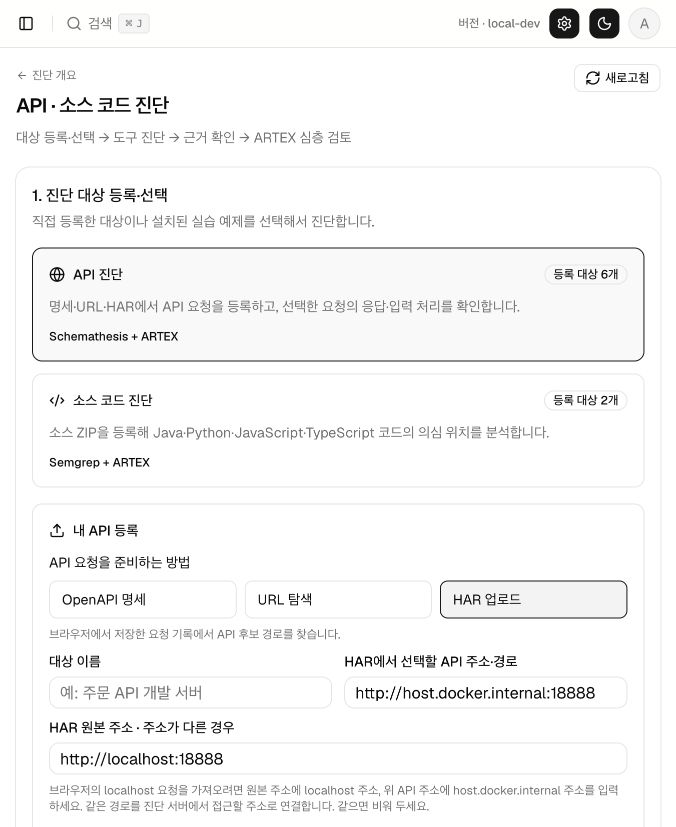
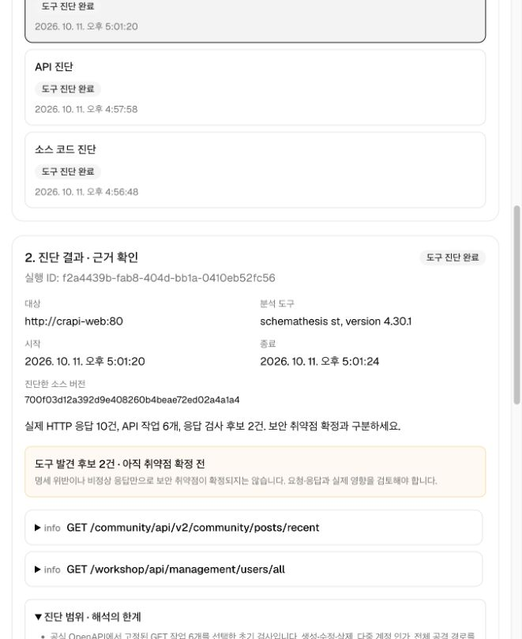
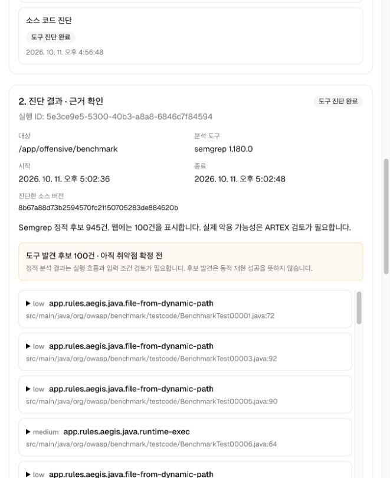

# API · 소스 코드 진단

Offensive에서 **API 명세·URL·HAR 또는 소스 ZIP을 등록 → 대상 선택 → 도구 진단 → 후보별 AI 검토·저장·이어하기** 순서로 사용합니다. crAPI·Benchmark는 선택 가능한 예제입니다. 탐지·Splunk·방어 검증 기능은 변경하지 않습니다.

## 시작

Docker를 실행한 뒤 저장소 루트에서:

```sh
./scripts/offensive-start.sh
```

첫 실행은 공식 실습 소스·이미지와 분석 도구를 내려받아 빌드합니다. 기존 ARTEX 계정·LLM 설정을 사용하며, 신규 설치라면 웹의 초기 설정을 완료하세요.

[Offensive → API · 소스 코드 진단 열기](http://localhost:8787/offensive/assessments/)

## 내 API 진단

1. **API 진단**을 선택하고 **OpenAPI 명세 / URL 탐색 / HAR 업로드** 중 하나를 고릅니다.
2. 대상 이름과 진단 컨테이너에서 접근할 수 있는 **API 기본 주소**를 입력합니다.
3. 아래 방식으로 요청 목록을 준비하고, 발견한 **GET/HEAD 경로**를 확인·선택합니다. 실행당 최대 40개입니다.
4. 필요한 경우 이번 검사에 쓸 Bearer 토큰을 입력하고 **API 진단 시작**을 누릅니다.
5. 실제 요청·응답, 검사 후보, 인증 제한과 탐색 공백을 확인합니다. 필요하면 아래 **후보별 AI 검토 · 이어하기**로 이어갑니다.

| 입력 방식 | 준비 방법 | 검사 범위 |
|---|---|---|
| OpenAPI 명세 | JSON/YAML 파일(8 MiB 이하) 등록 | 명세에 따른 입력 생성·응답 계약·서버 오류 검사 |
| URL 탐색 | 웹 또는 API 주소 입력 → **URL에서 API 찾기** | 같은 출처·지정 경로 범위의 HTML·연결된 JS에서 요청 후보를 찾고, 선택 후 서버 오류 검사 |
| HAR 업로드 | 실제 요청 기록 `.har`/`.json`(16 MiB 이하) 등록 | 지정된 출처·경로의 GET/HEAD 기록을 추출하고, 선택 후 서버 오류 검사 |

URL/HAR로 만든 요청 목록은 공식 명세가 아니므로 응답 계약 위반을 판정하지 않습니다. URL 탐색은 브라우저 JavaScript 실행이나 로그인 자동화를 하지 않으며, 찾은 문자열이 실제 API가 아닐 수 있습니다. 동적으로 만들어지는 요청과 로그인 후의 경로는 HAR로 보완할 수 있습니다.

### 로컬 crAPI로 연습

- URL 탐색: 기본 주소 `http://crapi-web:80` 입력 → 탐색 → 후보 선택.
- 명세 업로드: 같은 주소와 공식 crAPI 명세 파일을 등록합니다.
- HAR 업로드: 기본 주소 `http://host.docker.internal:18888`, 브라우저에서 기록한 원본 주소가 다르면 **HAR 원본 주소**에 `http://localhost:18888`을 입력합니다. 같은 출처의 기록이라면 원본 주소는 비워도 됩니다.

HAR 원본 주소는 파일에서 어떤 출처를 추출할지 지정하는 값입니다. 그 주소로 접속하지 않으며 실제 요청은 입력한 API 기본 주소로만 보냅니다. 경로는 유지하고, 다른 출처와 범위 밖의 요청은 제외합니다.

HAR는 브라우저 개발자 도구의 Network에서 실제 기능을 사용한 후 내보낼 수 있습니다. 원본 HAR의 인증 헤더·쿠키·쿼리값·본문은 보관하거나 자동 재사용하지 않습니다. 인증이 필요한 검사는 실행할 때 토큰을 따로 입력하세요. URL 경로 자체에 민감한 값이 들어 있는 기록은 업로드 전에 제거하세요.

API 기본 주소는 브라우저가 아니라 **진단 컨테이너에서 접근 가능한 주소**여야 합니다. 호스트 API는 `http://host.docker.internal:<포트>`, 원격 API는 점검 권한이 있는 서비스 주소를 사용합니다. 선택하지 않은 경로와 다른 호스트의 리다이렉트는 따라가지 않습니다.

현재 POST·PUT·PATCH·DELETE, 복잡한 OAuth 로그인, mTLS, API 전수 검사는 지원하지 않습니다. GET도 서비스 구현에 따라 부작용이 있을 수 있으므로 점검용 계정과 환경을 사용하세요. 401/403이나 404/405만 확인한 결과를 API가 안전하다는 뜻으로 해석하지 마세요.

## 내 소스 코드 진단

1. **소스 코드 진단**을 선택합니다.
2. 대상 이름과 **소스 ZIP(최대 20 MiB)**을 등록합니다.
3. 지원 언어·등록 파일 수를 확인하고 **소스 코드 진단 시작**을 누릅니다.
4. 후보의 **파일·줄·규칙·코드 문맥**을 확인합니다. 원본 결과와 해시도 내려받을 수 있습니다.

지원 언어는 **Java·Python·JavaScript·TypeScript**입니다. 코드를 빌드하거나 실행하지 않고 제한된 로컬 Semgrep 규칙으로 정적 후보를 찾습니다. Git 이력·의존성 디렉터리·대표적인 비밀 설정 파일은 제외하고 누락 범위를 결과에 남깁니다. 이 제외 처리가 모든 코드에 숨은 비밀값을 찾아내는 것은 아니므로 업로드 전 키·개인정보를 제거하세요.

등록한 대상은 목록에 유지됩니다. 소스가 바뀌었으면 새 ZIP을 등록하세요. 각 실행은 그때 선택한 대상·업로드 해시·근거를 보존합니다.

## 후보별 AI 검토 · 저장 · 이어하기

도구의 **후보는 확정 취약점이 아닙니다**. 도구 진단 완료와 AI 검토 완료는 별도로 표시합니다. 계약 위반·서버 오류·위험한 함수 사용만으로 실제 보안 영향을 확정하지 않습니다.

1. 도구 진단이 끝난 실행 이력에서 **3. 후보별 AI 검토 · 이어하기**를 엽니다.
2. **검토 모델**과 **한 번에 검토할 후보**를 선택합니다. 기본 3건이며 1~5건으로 조절할 수 있습니다.
3. **후보 AI 검토 시작**을 누릅니다. 후보 하나가 끝날 때마다 판정과 근거를 저장하고, 선택한 묶음을 처리하면 종료합니다.
4. **저장된 판정 / 전체 후보**, 후보별 요약·판정 근거·근거 ID·판단 한계를 확인합니다. 모델 호출·대기 시간과 실행 이력도 같은 화면에 남습니다.
5. 남은 후보가 있으면 **이어서 검토**를 누릅니다. 새로고침·중지·시간초과 후에도 저장된 판정은 유지하며, 아직 시도하지 않은 후보를 먼저 처리한 뒤 오류 후보를 재시도합니다.

| 판정 | 의미 |
|---|---|
| 정적 근거 확인 | 제공된 소스에서 결함의 근거를 확인. 실제 실행·악용 성공을 뜻하지 않음 |
| 후보 기각 | 제공된 근거에서 해당 후보를 반박하는 보호 로직·정상 동작 등을 확인 |
| 인증 필요 | 인증·인가 조건을 갖춘 별도 확인 필요 |
| 근거 부족 | 필요한 소스 흐름·응답·비교 자료가 부족 |
| 동적 검증 필요 | 의심 근거가 있으나 실행 환경에서 추가 확인 필요 |

**API**는 저장된 요청·응답 발췌만 검토하며 새 HTTP 요청이나 계정 간 비교를 실행하지 않습니다. 해당 경로의 저장된 응답이 모두 401/403이면 LLM을 호출하지 않고 **인증 필요 · 근거 자동 분류**로 저장합니다. 이는 인가 취약점 확정이나 안전 판정이 아닙니다. **소스**는 후보 주변의 제한된 코드 발췌와 정적 분석 근거를 검토하며 빌드·실행하지 않습니다. 후보별 판정은 이 화면에 저장되며 취약점 목록에 자동 등록하지 않습니다.

완료된 판정은 이어하기로 다시 처리하지 않습니다. 인증 조건·소스·요청 범위를 바꿔 확인하려면 **새 도구 진단**을 실행하세요. 예전에 연결한 작업은 **이전 ARTEX 검토 작업 열기**에서 계속 볼 수 있습니다.

### 호출 제한과 검토 예산

AI 검토에는 설정한 LLM과 사용량이 필요합니다. 진단 근거와 필요한 소스·응답 발췌가 선택한 모델로 전송되며, 도구 진단에 입력한 Bearer 토큰은 전달하지 않습니다. 명시적으로 선택한 모델은 시작 성공 후 이 브라우저의 후보 검토용 선택으로 기억하며, 전역 기본 모델은 바꾸지 않습니다.

- 후보 검토 요청은 API·소스 공용 순서대로 실행합니다. 선택한 수만 처리하며 추가 조사나 종료 정리용 작업을 만들지 않습니다.
- 후보당 제한시간은 최대 300초, 한 묶음은 최대 25분입니다. 출력은 기본 최대 3,000토큰이며 선택한 프로필에 더 낮은 상한이 있으면 따릅니다.
- 모델 오류·시간초과·응답 형식 오류가 나면 판정을 만들어 넣지 않고 이번 묶음을 멈춥니다. 저장된 결과를 확인한 뒤 남은 후보를 이어가세요.
- 분당 1회 설정은 호출 사이의 대기를 늘립니다. 화면의 호출 제한을 확인하고 **시스템 → LLM 설정**에서 공급자 한도에 맞는 검토용 프로필을 준비하세요. 큐 대기와 모델 호출·대기 시간은 구분해 표시하며, 중단된 호출의 토큰 사용량은 확인되지 않을 수 있습니다.

## API 입력 선택 화면

[후보별 검토·저장·이어하기 실제 검증 결과](evidence/offensive-candidate-review-validation-2026-10-11.md)



[URL·HAR 실제 웹 검증 결과](evidence/offensive-api-discovery-validation-2026-10-11.md)

[업로드·진단 실제 검증 결과](evidence/offensive-upload-validation-2026-10-11.md)

## 예제 환경

| 대상 | 실행 내용 |
|---|---|
| OWASP crAPI | 미리 선정한 GET API 6개, 일반 실습 계정 인증, Schemathesis 응답 검사 |
| OWASP Benchmark Java | 공식 Java 소스에 로컬 규칙 5개를 적용한 정적 분석 |

- [crAPI 웹](http://localhost:18888/) / [실습 메일](http://localhost:18025/)
- Benchmark는 소스만 연결하며 Java 웹 서버를 실행하지 않습니다.
- crAPI의 GenAI 챗봇과 외부 API 게이트웨이 실습은 포함하지 않습니다.

아래는 초기 예제 대상에서 실제 실행한 화면입니다. 사용자 업로드 대상은 같은 화면의 등록·선택 기능으로 진단합니다. 실습 이력은 새 설치에 포함되지 않습니다.





[초기 실행·검증 기록](evidence/offensive-assessments-2026-10-11.md)

## Skill · 도구 · MCP

- **Skill**: `api-assessment`, `source-assessment`는 기존 범용 ARTEX 작업의 진단·검토 지침입니다. 새 후보별 검토는 단일 후보와 저장된 근거를 처리하는 전용 프롬프트·검증기를 사용하며 Planner·Worker·Skill 호출을 반복하지 않습니다.
- **분석 도구**: Schemathesis와 Semgrep이 별도 실행 컨테이너에서 실제 진단합니다.
- **MCP**: 외부 도구 연결에 사용할 수 있는 인터페이스입니다. 이번 연동은 내부 HTTP API를 사용하므로 별도 MCP 설정은 필요하지 않습니다.

## 보관과 중지

```sh
./scripts/offensive-stop.sh
```

신규 진단 서비스만 중지하며 기존 ARTEX·Splunk와 저장된 근거는 유지됩니다. 다시 시작하려면 `offensive-start.sh`를 실행하세요.

- 실습 소스·실행기 인증 정보: Git에서 제외된 `.local-runtime/offensive/`
- 사용자 업로드 대상: `data/offensive/targets/`
- 진단 이력·근거: `data/offensive/runs/`
- 후보별 판정·검토 실행 이력: ARTEX의 PostgreSQL 저장소

업로드와 결과는 서버에 보관되며 Git과 Docker 빌드 대상에서 제외됩니다. ARTEX에는 업로드 소스를 읽기 전용으로 연결합니다. 사용자 API에 접근하기 위한 실행기만 외부 통신 네트워크에 연결하고, 취약 예제 서비스는 내부 Docker 네트워크에 둡니다. 예제 웹 공개 포트는 localhost로 제한합니다.

공식 예제 소스는 [crAPI](https://github.com/OWASP/crAPI/tree/700f03d12a392d9e408260b4beae72ed02a4a1a4), [Benchmark Java](https://github.com/OWASP-Benchmark/BenchmarkJava/tree/8b67a88d73b2594570fc21150705283de884620b) 커밋에 고정합니다. 다운로드한 제3자 소스는 각 프로젝트의 라이선스를 따르며 이 저장소에 복사해 배포하지 않습니다.
